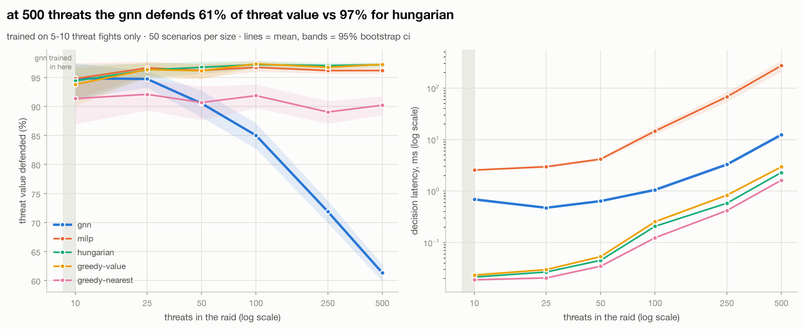

# salvo

[](https://github.com/j0hanj/salvo/actions/workflows/ci.yml)

who shoots what, when a swarm of cheap drones shows up at once and the radios are getting jammed.

salvo is a weapon-target assignment (WTA) testbed. it's a vectorized 2D engagement sim, exact MILP and
auction (CBBA) baselines, and a graph neural net assignment policy trained by imitation learning on
solver-optimal plans. the end state runs that policy decentralized across raspberry pi nodes that
coordinate over UDP while `tc netem` injects packet loss, latency, and burst outages.

## the problem

cheap drones flip the cost math on air defense: the interceptor costs orders of magnitude more than
the thing it's shooting down. so the whole game is allocation. which effector takes which threat,
solved fast, cost-aware, and re-planned every tick as the engagement evolves. jamming makes it worse:
anything that leans on a central node or a clean network degrades fast once links start dropping.

**question:** under increasing message loss, does a learned decentralized policy hold its intercept
rate better than CBBA, the standard consensus-based auction?

**headline metric:** % of threats stopped vs message-loss rate, every method on identical seeded
scenario suites, reported w confidence intervals.

## stack

- **sim:** numpy, struct-of-arrays, deterministic per seed. pro-nav guidance, swept-segment intercept
  checks, probabilistic kills.
- **baselines:** greedy, hungarian, MILP (OR-Tools) as ground truth at small N, CBBA
  ([choi, brunet & how 2009](https://ieeexplore.ieee.org/document/5072249)).
- **learned:** GNN over a threat-effector bipartite graph, behavior cloning from MILP labels w
  DAgger-style relabeling, trained at ~10 threats and evaluated zero-shot at 500+.
- **deployment:** ONNX export, C++20 inference, binary UDP message protocol, one pi per node,
  virtual nodes to scale past the hardware.

## roadmap

- [x] 0. repo + tooling
- [x] 1. sim, scenario generator, versioned eval suites
- [x] 2. baselines + eval harness
- [x] 3. learned centralized policy + scaling study (negative result, see below)
- [ ] 4. decentralized in sim: CBBA vs GNN under simulated loss
- [ ] 5. raspberry pi deployment
- [ ] 6. jamming sweeps + write-up

## one engagement

<picture>
  <source media="(prefers-color-scheme: dark)" srcset="docs/figures/engagement_example_dark.png">
  
</picture>

made by `scripts/render_engagement.py` (`make figures`). sim details in [docs/SIM.md](docs/SIM.md).

## baselines (phase 2)

<picture>
  <source media="(prefers-color-scheme: dark)" srcset="docs/figures/compare_suite_small_v2_dark.png">
  
</picture>

<!-- compare:suite_small_v2 -->
| method | threats stopped % | value defended % | Δ stopped vs milp | Δ value vs milp | cost per threat stopped | decision latency ms |
|---|---|---|---|---|---|---|
| greedy-nearest | 79.2 [76.5, 81.8] | 79.3 [76.1, 82.5] | -0.9 [-2.1, 0.4] | -8.1 [-10.6, -5.7] | 10.2 [9.0, 11.3] | 0.015 [0.015, 0.015] |
| greedy-value | 80.2 [77.7, 82.6] | 86.8 [84.3, 89.0] | 0.2 [-0.4, 0.8] | -0.6 [-1.5, 0.2] | 9.8 [8.7, 10.9] | 0.019 [0.019, 0.021] |
| hungarian | 80.6 [78.2, 83.1] | 87.1 [84.6, 89.4] | 0.6 [0.0, 1.3] | -0.3 [-1.4, 0.7] | 9.7 [8.7, 10.8] | 0.024 [0.022, 0.025] |
| milp | 80.0 [77.6, 82.4] | 87.4 [85.1, 89.5] | — | — | 10.0 [8.9, 11.1] | 2.627 [2.564, 2.692] |

`suite_small_v2`, 200 scenarios, every method on the same ones. means w 95% bootstrap cis over scenarios. Δs are paired per scenario, in pct points. latency = mean wall time of ticks that had a real decision. made by `scripts/compare.py` at `69675f4`.
<!-- /compare:suite_small_v2 -->

what this says so far: under saturation everyone stops about the same number of threats, but picking
*which* ones matters. nearest-first defends way less value than anything that looks at threat value.
exact per-tick MILP doesn't beat hungarian, because it's optimal per snapshot, not over the whole
raid (see [docs/FORMULATION.md](docs/FORMULATION.md)). that gap is the opening for a learned policy.

## learned policy + scaling (phase 3)

<picture>
  <source media="(prefers-color-scheme: dark)" srcset="docs/figures/scaling_dark.png">
  
</picture>

GNN trained by imitation (behavior cloning + 3 DAgger rounds) on 5-10 threat fights, then run
zero-shot on 10 to 500. how it works: [docs/LEARNED.md](docs/LEARNED.md).

**it doesn't generalize.** at training size it matches MILP. past that it degrades steadily, down to
61% of threat value at 500 threats vs 97% for hungarian. it isn't under-firing, it's *over*-firing:
at 100 threats it puts 3+ shooters on the same threat on 22% of targeted threats vs 7% for MILP
(`scripts/stacking.py`). likely cause: each effector picks its own best shot, and the only thing
stopping them from all picking the same one is the message passing. mean + max aggregation, picked
so the model wouldn't care about graph size, also can't tell 3 competing shooters from 50. if
that's right, the size invariance that was supposed to make it scale is exactly what breaks it.
not tested yet, that's the next experiment.

latency does scale: about 12 ms per decision at 500 threats vs about 270 ms for MILP. MILP also
slips slightly behind hungarian from 100 threats up (about 1 pt of value at 500).

<details><summary>full scaling table</summary>

<!-- scaling -->
| threats | method | value defended % | Δ value vs hungarian | threats stopped % | decision latency ms |
|---|---|---|---|---|---|
| 10 | greedy-nearest | 91.4 [87.0, 95.1] | -3.0 [-5.5, -1.0] | 92.0 [89.0, 94.8] | 0.02 [0.02, 0.02] |
| 10 | greedy-value | 93.8 [90.1, 96.7] | -0.6 [-1.6, 0.0] | 91.2 [87.8, 94.2] | 0.02 [0.02, 0.03] |
| 10 | hungarian | 94.4 [90.8, 97.1] | — | 91.8 [88.4, 94.8] | 0.02 [0.02, 0.02] |
| 10 | milp | 94.8 [91.3, 97.4] | 0.4 [-1.3, 2.1] | 91.4 [87.8, 94.6] | 2.56 [2.48, 2.64] |
| 10 | gnn | 94.8 [91.3, 97.4] | 0.4 [-1.2, 2.1] | 91.0 [87.6, 94.2] | 0.69 [0.64, 0.75] |
| 25 | greedy-nearest | 92.1 [89.3, 94.5] | -4.2 [-6.3, -2.3] | 92.2 [89.8, 94.3] | 0.02 [0.02, 0.02] |
| 25 | greedy-value | 96.4 [95.0, 97.5] | 0.1 [-0.5, 0.6] | 91.8 [89.4, 94.0] | 0.03 [0.03, 0.03] |
| 25 | hungarian | 96.3 [95.0, 97.4] | — | 91.4 [88.9, 93.8] | 0.03 [0.03, 0.03] |
| 25 | milp | 96.6 [95.4, 97.7] | 0.4 [-0.5, 1.2] | 91.6 [89.3, 93.8] | 2.97 [2.80, 3.18] |
| 25 | gnn | 94.7 [93.2, 96.1] | -1.6 [-2.5, -0.7] | 87.3 [84.6, 89.9] | 0.47 [0.46, 0.49] |
| 50 | greedy-nearest | 90.7 [87.6, 93.5] | -6.1 [-8.6, -3.7] | 90.0 [86.9, 92.7] | 0.03 [0.03, 0.04] |
| 50 | greedy-value | 96.1 [94.7, 97.3] | -0.6 [-1.8, 0.3] | 91.0 [88.5, 93.3] | 0.05 [0.05, 0.06] |
| 50 | hungarian | 96.7 [95.6, 97.7] | — | 91.6 [89.1, 93.7] | 0.05 [0.04, 0.05] |
| 50 | milp | 96.2 [94.9, 97.3] | -0.5 [-1.3, 0.2] | 89.0 [86.1, 91.6] | 4.17 [3.88, 4.49] |
| 50 | gnn | 90.5 [88.1, 92.7] | -6.2 [-8.3, -4.3] | 76.6 [72.3, 80.6] | 0.64 [0.62, 0.66] |
| 100 | greedy-nearest | 91.9 [89.7, 93.8] | -5.3 [-7.1, -3.7] | 91.1 [89.1, 92.9] | 0.12 [0.12, 0.13] |
| 100 | greedy-value | 97.3 [96.8, 97.9] | 0.1 [-0.2, 0.6] | 92.2 [90.6, 93.7] | 0.25 [0.24, 0.27] |
| 100 | hungarian | 97.2 [96.5, 97.8] | — | 92.1 [90.4, 93.7] | 0.21 [0.20, 0.21] |
| 100 | milp | 96.7 [96.0, 97.4] | -0.5 [-0.8, -0.1] | 89.1 [87.3, 90.9] | 14.63 [12.37, 17.17] |
| 100 | gnn | 85.0 [82.7, 87.1] | -12.2 [-14.2, -10.3] | 63.3 [60.0, 66.5] | 1.05 [0.98, 1.14] |
| 250 | greedy-nearest | 89.0 [87.1, 90.9] | -8.0 [-9.7, -6.4] | 89.0 [87.2, 90.7] | 0.42 [0.41, 0.42] |
| 250 | greedy-value | 96.8 [96.3, 97.2] | -0.3 [-0.6, 0.0] | 90.1 [88.6, 91.6] | 0.83 [0.79, 0.88] |
| 250 | hungarian | 97.1 [96.6, 97.5] | — | 90.6 [89.0, 92.1] | 0.58 [0.58, 0.59] |
| 250 | milp | 96.2 [95.6, 96.7] | -0.9 [-1.2, -0.6] | 85.9 [84.1, 87.7] | 67.75 [53.73, 83.73] |
| 250 | gnn | 71.9 [69.9, 73.8] | -25.2 [-27.0, -23.4] | 43.2 [41.1, 45.2] | 3.29 [3.05, 3.53] |
| 500 | greedy-nearest | 90.2 [88.5, 91.8] | -7.0 [-8.4, -5.6] | 90.0 [88.3, 91.6] | 1.62 [1.61, 1.64] |
| 500 | greedy-value | 97.2 [96.8, 97.6] | 0.1 [-0.1, 0.2] | 91.3 [89.8, 92.7] | 2.96 [2.83, 3.09] |
| 500 | hungarian | 97.2 [96.8, 97.6] | — | 91.2 [89.7, 92.7] | 2.29 [2.28, 2.31] |
| 500 | milp | 96.2 [95.7, 96.7] | -1.0 [-1.2, -0.7] | 86.4 [84.8, 88.1] | 272.43 [209.42, 341.30] |
| 500 | gnn | 61.3 [59.9, 62.7] | -35.8 [-37.1, -34.7] | 31.4 [30.2, 32.6] | 12.40 [11.15, 13.73] |

`suite_scale_n*_v1`, 50 scenarios per size, same scenarios for every method. 95% bootstrap cis, Δ paired per scenario. milp solves are capped at 5s each. gnn trained on 5-10 threats only (`scripts/train.py` at `8bb2ef4`). made by `scripts/scaling.py` at `af0bf0b`.
<!-- /scaling -->

</details>

## setup

```
brew install uv   # or see astral.sh/uv
make setup
make test
make lint
make figures   # rebuilds every figure in this readme
```

## scope

everything is abstract. threats and effectors are points w made-up range, speed, and kill-probability
parameters. no real systems, no real specs, nothing export-controlled. an "intercept" is two points
getting within a radius. it's a resource-allocation problem at heart.
