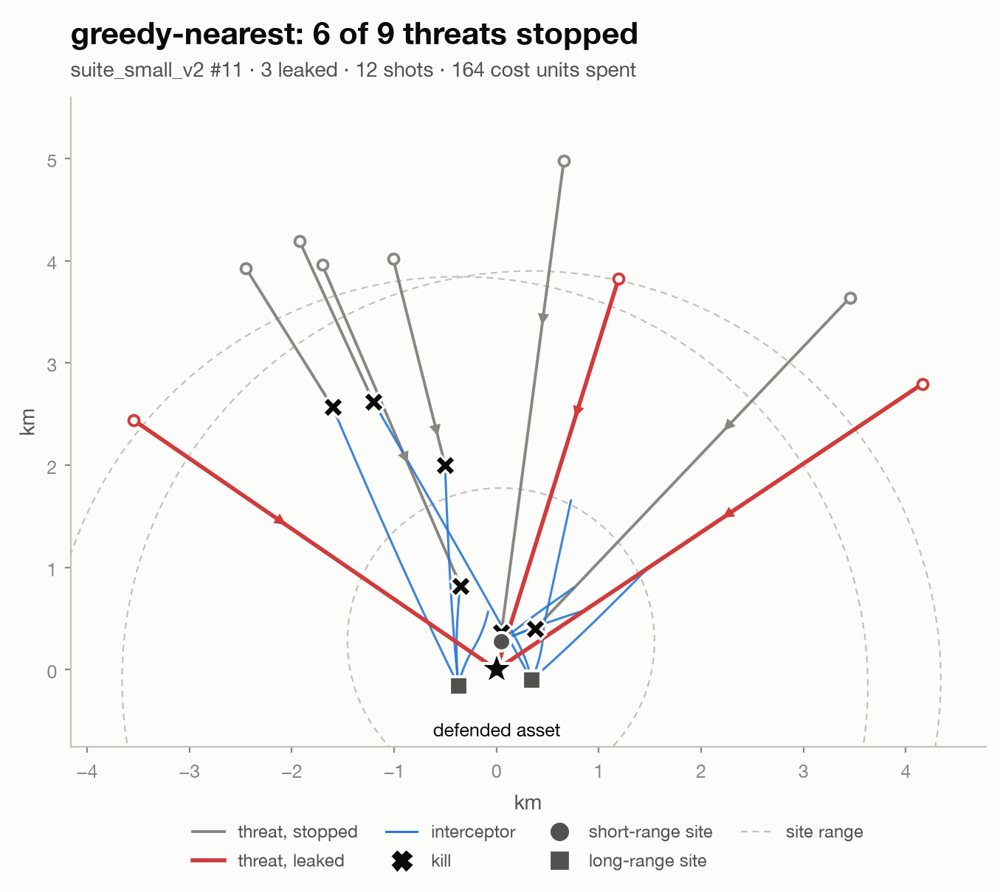
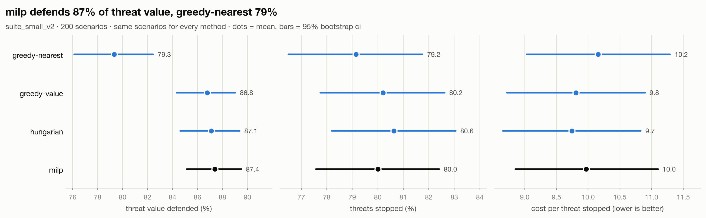
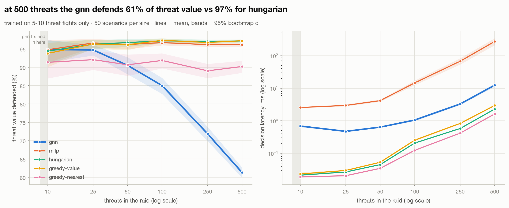
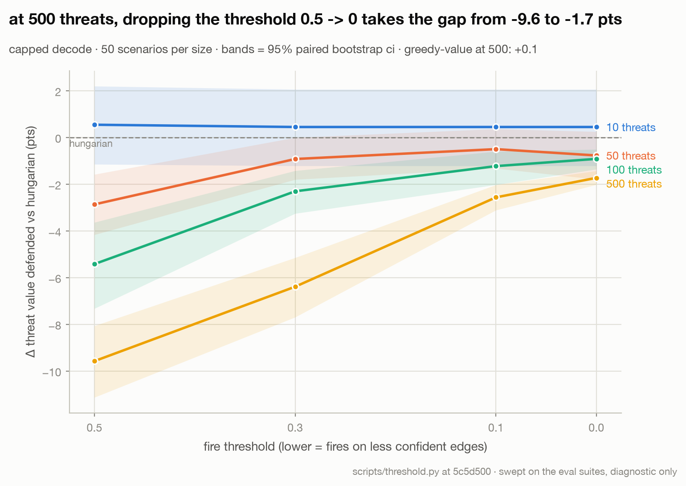

# salvo

[](https://github.com/j0hanj/salvo/actions/workflows/ci.yml)

who shoots what, when a swarm of cheap drones shows up at once and the radios are getting jammed.

salvo is a weapon-target assignment (WTA) testbed. it's a vectorized 2D engagement sim, exact MILP and
auction (CBBA) baselines, and a graph neural net assignment policy trained by imitation learning on
solver-optimal plans. the end state runs that policy decentralized across raspberry pi nodes that
coordinate over UDP while `tc netem` injects packet loss, latency, and burst outages.

## the problem

cheap drones flip the cost math on air defense: the interceptor costs orders of magnitude more than
the thing it's shooting down. so the whole game is allocation. which effector takes which threat,
solved fast, cost-aware, and re-planned every tick as the engagement evolves. jamming makes it worse:
anything that leans on a central node or a clean network degrades fast once links start dropping.

**question:** under increasing message loss, does a learned decentralized policy hold its intercept
rate better than CBBA, the standard consensus-based auction?

**headline metric:** % of threats stopped vs message-loss rate, every method on identical seeded
scenario suites, reported w confidence intervals.

## stack

- **sim:** numpy, struct-of-arrays, deterministic per seed. pro-nav guidance, swept-segment intercept
  checks, probabilistic kills.
- **baselines:** greedy, hungarian, MILP (OR-Tools) as ground truth at small N, CBBA
  ([choi, brunet & how 2009](https://ieeexplore.ieee.org/document/5072249)).
- **learned:** GNN over a threat-effector bipartite graph, behavior cloning from MILP labels w
  DAgger-style relabeling, trained at ~10 threats and evaluated zero-shot at 500+.
- **deployment:** ONNX export, C++20 inference, binary UDP message protocol, one pi per node,
  virtual nodes to scale past the hardware.

## roadmap

- [x] 0. repo + tooling
- [x] 1. sim, scenario generator, versioned eval suites
- [x] 2. baselines + eval harness
- [x] 3. learned centralized policy + scaling study (negative result, see below)
- [ ] 4. decentralized in sim: CBBA vs GNN under simulated loss
- [ ] 5. raspberry pi deployment
- [ ] 6. jamming sweeps + write-up

## one engagement

<picture>
  <source media="(prefers-color-scheme: dark)" srcset="docs/figures/engagement_example_dark.png">
  
</picture>

made by `scripts/render_engagement.py` (`make figures`). sim details in [docs/SIM.md](docs/SIM.md).

## baselines (phase 2)

<picture>
  <source media="(prefers-color-scheme: dark)" srcset="docs/figures/compare_suite_small_v2_dark.png">
  
</picture>

<!-- compare:suite_small_v2 -->
| method | threats stopped % | value defended % | Δ stopped vs milp | Δ value vs milp | cost per threat stopped | decision latency ms |
|---|---|---|---|---|---|---|
| greedy-nearest | 79.2 [76.5, 81.8] | 79.3 [76.1, 82.5] | -0.9 [-2.1, 0.4] | -8.1 [-10.6, -5.7] | 10.2 [9.0, 11.3] | 0.015 [0.015, 0.015] |
| greedy-value | 80.2 [77.7, 82.6] | 86.8 [84.3, 89.0] | 0.2 [-0.4, 0.8] | -0.6 [-1.5, 0.2] | 9.8 [8.7, 10.9] | 0.019 [0.019, 0.021] |
| hungarian | 80.6 [78.2, 83.1] | 87.1 [84.6, 89.4] | 0.6 [0.0, 1.3] | -0.3 [-1.4, 0.7] | 9.7 [8.7, 10.8] | 0.024 [0.022, 0.025] |
| milp | 80.0 [77.6, 82.4] | 87.4 [85.1, 89.5] | — | — | 10.0 [8.9, 11.1] | 2.627 [2.564, 2.692] |

`suite_small_v2`, 200 scenarios, every method on the same ones. means w 95% bootstrap cis over scenarios. Δs are paired per scenario, in pct points. latency = mean wall time of ticks that had a real decision. made by `scripts/compare.py` at `69675f4`.
<!-- /compare:suite_small_v2 -->

what this says so far: under saturation everyone stops about the same number of threats, but picking
*which* ones matters. nearest-first defends way less value than anything that looks at threat value.
exact per-tick MILP doesn't beat hungarian, because it's optimal per snapshot, not over the whole
raid (see [docs/FORMULATION.md](docs/FORMULATION.md)). that gap is the opening for a learned policy.

## learned policy + scaling (phase 3)

<picture>
  <source media="(prefers-color-scheme: dark)" srcset="docs/figures/scaling_dark.png">
  
</picture>

GNN trained by imitation (behavior cloning + 3 DAgger rounds) on 5-10 threat fights, then run
zero-shot on 10 to 500. how it works: [docs/LEARNED.md](docs/LEARNED.md).

**it doesn't generalize.** at training size it matches MILP. past that it degrades steadily, down to
61% of threat value at 500 threats vs 97% for hungarian. it isn't under-firing, it's *over*-firing:
at 100 threats it puts 3+ shooters on the same threat on 22% of targeted threats vs 7% for MILP
(`scripts/stacking.py`). likely cause: each effector picks its own best shot, and the only thing
stopping them from all picking the same one is the message passing. mean + max aggregation, picked
so the model wouldn't care about graph size, also can't tell 3 competing shooters from 50. tested
that below, and it's mostly wrong.

latency does scale: about 12 ms per decision at 500 threats vs about 270 ms for MILP. MILP also
slips slightly behind hungarian from 100 threats up (about 1 pt of value at 500).

<details><summary>full scaling table</summary>

<!-- scaling -->
| threats | method | value defended % | Δ value vs hungarian | threats stopped % | decision latency ms |
|---|---|---|---|---|---|
| 10 | greedy-nearest | 91.4 [87.0, 95.1] | -3.0 [-5.5, -1.0] | 92.0 [89.0, 94.8] | 0.02 [0.02, 0.02] |
| 10 | greedy-value | 93.8 [90.1, 96.7] | -0.6 [-1.6, 0.0] | 91.2 [87.8, 94.2] | 0.02 [0.02, 0.03] |
| 10 | hungarian | 94.4 [90.8, 97.1] | — | 91.8 [88.4, 94.8] | 0.02 [0.02, 0.02] |
| 10 | milp | 94.8 [91.3, 97.4] | 0.4 [-1.3, 2.1] | 91.4 [87.8, 94.6] | 2.56 [2.48, 2.64] |
| 10 | gnn | 94.8 [91.3, 97.4] | 0.4 [-1.2, 2.1] | 91.0 [87.6, 94.2] | 0.69 [0.64, 0.75] |
| 25 | greedy-nearest | 92.1 [89.3, 94.5] | -4.2 [-6.3, -2.3] | 92.2 [89.8, 94.3] | 0.02 [0.02, 0.02] |
| 25 | greedy-value | 96.4 [95.0, 97.5] | 0.1 [-0.5, 0.6] | 91.8 [89.4, 94.0] | 0.03 [0.03, 0.03] |
| 25 | hungarian | 96.3 [95.0, 97.4] | — | 91.4 [88.9, 93.8] | 0.03 [0.03, 0.03] |
| 25 | milp | 96.6 [95.4, 97.7] | 0.4 [-0.5, 1.2] | 91.6 [89.3, 93.8] | 2.97 [2.80, 3.18] |
| 25 | gnn | 94.7 [93.2, 96.1] | -1.6 [-2.5, -0.7] | 87.3 [84.6, 89.9] | 0.47 [0.46, 0.49] |
| 50 | greedy-nearest | 90.7 [87.6, 93.5] | -6.1 [-8.6, -3.7] | 90.0 [86.9, 92.7] | 0.03 [0.03, 0.04] |
| 50 | greedy-value | 96.1 [94.7, 97.3] | -0.6 [-1.8, 0.3] | 91.0 [88.5, 93.3] | 0.05 [0.05, 0.06] |
| 50 | hungarian | 96.7 [95.6, 97.7] | — | 91.6 [89.1, 93.7] | 0.05 [0.04, 0.05] |
| 50 | milp | 96.2 [94.9, 97.3] | -0.5 [-1.3, 0.2] | 89.0 [86.1, 91.6] | 4.17 [3.88, 4.49] |
| 50 | gnn | 90.5 [88.1, 92.7] | -6.2 [-8.3, -4.3] | 76.6 [72.3, 80.6] | 0.64 [0.62, 0.66] |
| 100 | greedy-nearest | 91.9 [89.7, 93.8] | -5.3 [-7.1, -3.7] | 91.1 [89.1, 92.9] | 0.12 [0.12, 0.13] |
| 100 | greedy-value | 97.3 [96.8, 97.9] | 0.1 [-0.2, 0.6] | 92.2 [90.6, 93.7] | 0.25 [0.24, 0.27] |
| 100 | hungarian | 97.2 [96.5, 97.8] | — | 92.1 [90.4, 93.7] | 0.21 [0.20, 0.21] |
| 100 | milp | 96.7 [96.0, 97.4] | -0.5 [-0.8, -0.1] | 89.1 [87.3, 90.9] | 14.63 [12.37, 17.17] |
| 100 | gnn | 85.0 [82.7, 87.1] | -12.2 [-14.2, -10.3] | 63.3 [60.0, 66.5] | 1.05 [0.98, 1.14] |
| 250 | greedy-nearest | 89.0 [87.1, 90.9] | -8.0 [-9.7, -6.4] | 89.0 [87.2, 90.7] | 0.42 [0.41, 0.42] |
| 250 | greedy-value | 96.8 [96.3, 97.2] | -0.3 [-0.6, 0.0] | 90.1 [88.6, 91.6] | 0.83 [0.79, 0.88] |
| 250 | hungarian | 97.1 [96.6, 97.5] | — | 90.6 [89.0, 92.1] | 0.58 [0.58, 0.59] |
| 250 | milp | 96.2 [95.6, 96.7] | -0.9 [-1.2, -0.6] | 85.9 [84.1, 87.7] | 67.75 [53.73, 83.73] |
| 250 | gnn | 71.9 [69.9, 73.8] | -25.2 [-27.0, -23.4] | 43.2 [41.1, 45.2] | 3.29 [3.05, 3.53] |
| 500 | greedy-nearest | 90.2 [88.5, 91.8] | -7.0 [-8.4, -5.6] | 90.0 [88.3, 91.6] | 1.62 [1.61, 1.64] |
| 500 | greedy-value | 97.2 [96.8, 97.6] | 0.1 [-0.1, 0.2] | 91.3 [89.8, 92.7] | 2.96 [2.83, 3.09] |
| 500 | hungarian | 97.2 [96.8, 97.6] | — | 91.2 [89.7, 92.7] | 2.29 [2.28, 2.31] |
| 500 | milp | 96.2 [95.7, 96.7] | -1.0 [-1.2, -0.7] | 86.4 [84.8, 88.1] | 272.43 [209.42, 341.30] |
| 500 | gnn | 61.3 [59.9, 62.7] | -35.8 [-37.1, -34.7] | 31.4 [30.2, 32.6] | 12.40 [11.15, 13.73] |

`suite_scale_n*_v1`, 50 scenarios per size, same scenarios for every method. 95% bootstrap cis, Δ paired per scenario. milp solves are capped at 5s each. gnn trained on 5-10 threats only (`scripts/train.py` at `8bb2ef4`). made by `scripts/scaling.py` at `af0bf0b`.
<!-- /scaling -->

</details>

### what's actually causing it (ablation)

2x2: {plain, + a log-degree channel so nodes can count competing shooters} x {argmax decode where
every effector picks on its own, capped decode that walks shots most-confident-first and stops
adding shooters once a threat's covered}. degree model trained w the same recipe + `--degree`.

at 500 threats: the degree channel barely moves it (61.3 -> 64.4% of value) and it still stacks 3+
shooters on 37% of targeted threats. capped decode gets it to 87.6% w zero stacking. so most of the
damage is independent per-effector decoding, not the aggregation. combining both is worse than
capped alone (81.7%). and even w zero stacking it only stops 65% of threats at 500 vs 91% for
hungarian, so there's a second failure mode left (next section).

<details><summary>ablation table</summary>

<!-- ablation -->
| threats | method | value defended % | Δ value vs hungarian | threats stopped % | targeted threats w 3+ shooters % | decision latency ms |
|---|---|---|---|---|---|---|
| 10 | hungarian | 94.4 [90.8, 97.1] | — | 91.8 [88.4, 94.8] | 0.0 [0.0, 0.0] | 0.02 [0.02, 0.02] |
| 10 | milp | 94.8 [91.3, 97.4] | 0.4 [-1.3, 2.1] | 91.4 [87.8, 94.6] | 0.5 [0.0, 1.2] | 2.44 [2.30, 2.64] |
| 10 | gnn | 94.8 [91.3, 97.4] | 0.4 [-1.2, 2.1] | 91.0 [87.6, 94.2] | 0.5 [0.0, 1.2] | 0.62 [0.47, 0.77] |
| 10 | gnn capped | 94.9 [91.4, 97.5] | 0.5 [-1.2, 2.2] | 91.4 [88.0, 94.4] | 0.0 [0.0, 0.0] | 0.43 [0.42, 0.44] |
| 10 | gnn+deg | 94.9 [91.5, 97.5] | 0.5 [-1.0, 2.1] | 91.4 [88.0, 94.4] | 0.5 [0.0, 1.2] | 0.49 [0.47, 0.52] |
| 10 | gnn+deg capped | 95.4 [92.0, 97.8] | 1.0 [-0.1, 2.3] | 92.0 [88.6, 95.0] | 0.0 [0.0, 0.0] | 0.43 [0.43, 0.44] |
| 50 | hungarian | 96.7 [95.6, 97.7] | — | 91.6 [89.1, 93.7] | 0.0 [0.0, 0.0] | 0.04 [0.04, 0.04] |
| 50 | milp | 96.2 [94.9, 97.3] | -0.5 [-1.3, 0.2] | 89.0 [86.1, 91.6] | 5.0 [4.2, 5.8] | 3.62 [3.37, 3.90] |
| 50 | gnn | 90.5 [88.1, 92.7] | -6.2 [-8.3, -4.3] | 76.6 [72.3, 80.6] | 12.4 [10.9, 13.9] | 0.54 [0.53, 0.55] |
| 50 | gnn capped | 93.9 [92.2, 95.5] | -2.9 [-4.2, -1.6] | 83.5 [79.8, 87.0] | 0.0 [0.0, 0.0] | 0.52 [0.51, 0.53] |
| 50 | gnn+deg | 91.5 [89.4, 93.4] | -5.2 [-6.9, -3.8] | 77.9 [74.2, 81.5] | 11.8 [10.6, 13.1] | 0.79 [0.66, 0.95] |
| 50 | gnn+deg capped | 93.4 [91.2, 95.3] | -3.3 [-5.2, -1.7] | 83.7 [80.1, 87.2] | 0.0 [0.0, 0.0] | 0.83 [0.80, 0.86] |
| 100 | hungarian | 97.2 [96.5, 97.8] | — | 92.1 [90.4, 93.7] | 0.0 [0.0, 0.0] | 0.12 [0.12, 0.13] |
| 100 | milp | 96.7 [96.0, 97.4] | -0.5 [-0.8, -0.1] | 89.1 [87.3, 90.9] | 6.5 [5.8, 7.2] | 12.41 [10.40, 14.71] |
| 100 | gnn | 85.0 [82.7, 87.1] | -12.2 [-14.2, -10.3] | 63.3 [60.0, 66.5] | 22.3 [21.0, 23.6] | 1.26 [1.18, 1.34] |
| 100 | gnn capped | 91.8 [89.6, 93.9] | -5.4 [-7.3, -3.6] | 78.7 [74.7, 82.7] | 0.0 [0.0, 0.0] | 0.86 [0.81, 0.91] |
| 100 | gnn+deg | 84.6 [82.6, 86.5] | -12.6 [-14.2, -11.0] | 64.1 [61.7, 66.5] | 18.2 [17.3, 19.2] | 0.76 [0.73, 0.78] |
| 100 | gnn+deg capped | 91.1 [89.1, 92.9] | -6.1 [-7.6, -4.7] | 78.5 [75.3, 81.6] | 0.0 [0.0, 0.0] | 0.70 [0.68, 0.72] |
| 500 | hungarian | 97.2 [96.8, 97.6] | — | 91.2 [89.7, 92.7] | 0.0 [0.0, 0.0] | 2.00 [1.99, 2.02] |
| 500 | gnn | 61.3 [59.9, 62.7] | -35.8 [-37.1, -34.7] | 31.4 [30.2, 32.6] | 48.6 [47.5, 49.6] | 10.41 [9.46, 11.41] |
| 500 | gnn capped | 87.6 [85.8, 89.3] | -9.6 [-11.1, -8.1] | 65.2 [62.2, 68.3] | 0.0 [0.0, 0.0] | 13.17 [11.76, 14.64] |
| 500 | gnn+deg | 64.4 [62.4, 66.3] | -32.8 [-34.4, -31.1] | 36.8 [35.0, 38.6] | 36.5 [35.4, 37.6] | 12.55 [11.30, 13.86] |
| 500 | gnn+deg capped | 81.7 [79.1, 84.2] | -15.5 [-17.8, -13.2] | 61.2 [57.4, 64.9] | 0.0 [0.0, 0.0] | 12.18 [10.88, 13.50] |

`suite_scale_n*_v1`, 50 scenarios per size, same scenarios for every method. 95% bootstrap cis, Δ paired per scenario. 3+ shooters = share of (tick, targeted threat) pairs w 3 or more interceptors launched at it, averaged per scenario. models from `scripts/train.py` at `8bb2ef4` (plain) and `cdf40a9` (+deg). made by `scripts/ablation.py` at `cdf40a9`.
<!-- /ablation -->

</details>

### the leftover gap is mostly the fire threshold

capped decode only fires on edges scoring >= 0.5. the model's scores shrink as the graph grows:
median best-edge score per free effector is 1.00 at 10 threats and 0.64 at 500, where 43% of free
effectors don't have a single edge above 0.5. at 500, 72% of free effectors sit idle while a
threat they could reach is still uncovered (`scripts/confidence.py`).

sweeping the threshold (`scripts/threshold.py`): at 500 threats, value defended goes 87.6 (0.5) ->
90.8 (0.3) -> 94.6 (0.1) -> 95.4 (0.0), threats stopped 65.2 -> 84.9. at 10 threats it doesn't
matter. but at threshold 0 capped decode is just "rank edges by the model's score, fill greedily",
and a hand-written ranking does that better: greedy-value gets 97.2 at 500 w 1.00x hungarian's
shots, the gnn 95.4 w 1.16x. the threshold was swept on the eval suites, so this is a diagnostic,
not a tuned number.

<picture>
  <source media="(prefers-color-scheme: dark)" srcset="docs/figures/threshold_dark.png">
  
</picture>

<details><summary>confidence + threshold tables</summary>

<!-- confidence -->
| threats | best edge score, median [p10, p90] | effectors w best score < 0.5 % | idle w an uncovered legal target % | fired % |
|---|---|---|---|---|
| 10 | 1.00 [0.99, 1.00] | 0.4 [0.0, 1.0] | 0.4 [0.0, 1.0] | 98.5 [97.7, 99.3] |
| 50 | 0.98 [0.27, 1.00] | 21.2 [16.2, 26.5] | 26.8 [21.3, 32.5] | 65.3 [60.0, 70.5] |
| 100 | 0.61 [0.20, 1.00] | 40.6 [36.5, 44.6] | 54.1 [50.2, 57.9] | 37.6 [34.4, 41.1] |
| 500 | 0.64 [0.16, 1.00] | 42.6 [40.4, 44.9] | 71.8 [70.3, 73.3] | 18.1 [17.0, 19.2] |

`suite_scale_n*_v1`, 50 scenarios per size, gnn w capped decode at threshold 0.5. one row = every (tick, free effector w at least one legal shot). idle w an uncovered legal target = didn't fire even though some threat it could reach was still below the coverage floor after decode, so only the threshold held it back. 95% bootstrap cis over scenarios. model `20261029-213442-train`. made by `scripts/confidence.py` at `ec2f8cd`.
<!-- /confidence -->

<!-- threshold -->
| threats | method | value defended % | Δ value vs hungarian | threats stopped % | shots vs hungarian | targeted threats w 3+ shooters % |
|---|---|---|---|---|---|---|
| 10 | hungarian | 94.4 [90.8, 97.1] | — | 91.8 [88.4, 94.8] | 1.00 [1.00, 1.00]x | 0.0 [0.0, 0.0] |
| 10 | greedy-value | 93.8 [90.1, 96.7] | -0.6 [-1.6, 0.0] | 91.2 [87.8, 94.2] | 1.00 [0.99, 1.00]x | 0.0 [0.0, 0.0] |
| 10 | gnn capped @0.5 | 94.9 [91.4, 97.5] | 0.5 [-1.2, 2.2] | 91.4 [88.0, 94.4] | 1.04 [1.02, 1.07]x | 0.0 [0.0, 0.0] |
| 10 | gnn capped @0.3 | 94.8 [91.3, 97.4] | 0.4 [-1.2, 2.1] | 91.2 [87.8, 94.2] | 1.05 [1.03, 1.07]x | 0.0 [0.0, 0.0] |
| 10 | gnn capped @0.1 | 94.8 [91.3, 97.4] | 0.4 [-1.2, 2.1] | 91.2 [87.8, 94.2] | 1.05 [1.03, 1.07]x | 0.0 [0.0, 0.0] |
| 10 | gnn capped @0.0 | 94.8 [91.3, 97.4] | 0.4 [-1.2, 2.1] | 91.2 [87.8, 94.2] | 1.05 [1.03, 1.07]x | 0.0 [0.0, 0.0] |
| 50 | hungarian | 96.7 [95.6, 97.7] | — | 91.6 [89.1, 93.7] | 1.00 [1.00, 1.00]x | 0.0 [0.0, 0.0] |
| 50 | greedy-value | 96.1 [94.7, 97.3] | -0.6 [-1.8, 0.3] | 91.0 [88.5, 93.3] | 1.00 [0.99, 1.01]x | 0.0 [0.0, 0.0] |
| 50 | gnn capped @0.5 | 93.9 [92.2, 95.5] | -2.9 [-4.2, -1.6] | 83.5 [79.8, 87.0] | 1.08 [1.05, 1.12]x | 0.0 [0.0, 0.0] |
| 50 | gnn capped @0.3 | 95.8 [94.5, 96.9] | -0.9 [-1.8, -0.0] | 86.6 [83.6, 89.3] | 1.12 [1.10, 1.14]x | 0.0 [0.0, 0.0] |
| 50 | gnn capped @0.1 | 96.2 [95.1, 97.3] | -0.5 [-1.3, 0.4] | 87.7 [84.8, 90.4] | 1.13 [1.11, 1.16]x | 0.0 [0.0, 0.0] |
| 50 | gnn capped @0.0 | 96.0 [94.8, 97.0] | -0.8 [-1.8, 0.2] | 87.7 [85.0, 90.2] | 1.13 [1.11, 1.15]x | 0.0 [0.0, 0.0] |
| 100 | hungarian | 97.2 [96.5, 97.8] | — | 92.1 [90.4, 93.7] | 1.00 [1.00, 1.00]x | 0.0 [0.0, 0.0] |
| 100 | greedy-value | 97.3 [96.8, 97.9] | 0.1 [-0.2, 0.6] | 92.2 [90.6, 93.7] | 1.00 [0.99, 1.00]x | 0.0 [0.0, 0.0] |
| 100 | gnn capped @0.5 | 91.8 [89.6, 93.9] | -5.4 [-7.3, -3.6] | 78.7 [74.7, 82.7] | 1.04 [0.99, 1.08]x | 0.0 [0.0, 0.0] |
| 100 | gnn capped @0.3 | 94.9 [93.5, 96.2] | -2.3 [-3.3, -1.4] | 84.8 [81.8, 87.7] | 1.11 [1.08, 1.14]x | 0.0 [0.0, 0.0] |
| 100 | gnn capped @0.1 | 96.0 [95.0, 96.9] | -1.2 [-2.0, -0.6] | 87.7 [85.7, 89.6] | 1.14 [1.12, 1.15]x | 0.0 [0.0, 0.0] |
| 100 | gnn capped @0.0 | 96.3 [95.4, 97.1] | -0.9 [-1.4, -0.5] | 88.2 [86.3, 90.0] | 1.14 [1.12, 1.16]x | 0.0 [0.0, 0.0] |
| 500 | hungarian | 97.2 [96.8, 97.6] | — | 91.2 [89.7, 92.7] | 1.00 [1.00, 1.00]x | 0.0 [0.0, 0.0] |
| 500 | greedy-value | 97.2 [96.8, 97.6] | 0.1 [-0.1, 0.2] | 91.3 [89.8, 92.7] | 1.00 [1.00, 1.00]x | 0.0 [0.0, 0.0] |
| 500 | gnn capped @0.5 | 87.6 [85.8, 89.3] | -9.6 [-11.1, -8.1] | 65.2 [62.2, 68.3] | 0.91 [0.87, 0.94]x | 0.0 [0.0, 0.0] |
| 500 | gnn capped @0.3 | 90.8 [89.2, 92.2] | -6.4 [-7.7, -5.1] | 70.9 [67.8, 73.8] | 0.99 [0.96, 1.02]x | 0.0 [0.0, 0.0] |
| 500 | gnn capped @0.1 | 94.6 [93.8, 95.4] | -2.6 [-3.1, -2.0] | 80.0 [77.9, 82.0] | 1.11 [1.09, 1.13]x | 0.0 [0.0, 0.0] |
| 500 | gnn capped @0.0 | 95.4 [94.8, 96.1] | -1.7 [-2.0, -1.4] | 84.9 [83.0, 86.8] | 1.16 [1.15, 1.18]x | 0.0 [0.0, 0.0] |

`suite_scale_n*_v1`, 50 scenarios per size, same scenarios for every method. gnn w capped decode at each fire threshold. shots vs hungarian = interceptors launched per scenario / hungarian's on the same scenario. 95% bootstrap cis, Δ paired per scenario. threshold swept on the eval suites, so read it as a diagnostic, not a tuned result. model from `scripts/train.py` at `8bb2ef4`. made by `scripts/threshold.py` at `5c5d500`.
<!-- /threshold -->

</details>

### training on bigger fights fixes calibration only up to the sizes it saw

same recipe, trained on 5-10 + 25 + 50 threat fights (`scripts/train.py --suites suite_train_v1
suite_train_n25_v1 suite_train_n50_v1`), same threshold sweep (`scripts/threshold.py --tag
mixed`). at default threshold 0.5, Δ value vs hungarian at 100 threats goes -5.4 (5-10 only) ->
-2.3 (mixed), and from 50 down the threshold barely matters anymore. at 500, past anything it
trained on, it's no better: -11.4 [-13.3, -9.6] at 0.5 and -1.9 [-2.3, -1.6] at 0.0, vs -9.6 and
-1.7 for the 5-10 model. greedy-value is still +0.1 there.

<details><summary>mixed-size threshold table</summary>

<!-- threshold_mixed -->
| threats | method | value defended % | Δ value vs hungarian | threats stopped % | shots vs hungarian | targeted threats w 3+ shooters % |
|---|---|---|---|---|---|---|
| 10 | hungarian | 94.4 [90.8, 97.1] | — | 91.8 [88.4, 94.8] | 1.00 [1.00, 1.00]x | 0.0 [0.0, 0.0] |
| 10 | greedy-value | 93.8 [90.1, 96.7] | -0.6 [-1.6, 0.0] | 91.2 [87.8, 94.2] | 1.00 [0.99, 1.00]x | 0.0 [0.0, 0.0] |
| 10 | gnn capped @0.5 | 94.6 [91.2, 97.2] | 0.2 [-1.3, 1.8] | 90.8 [87.4, 93.8] | 1.04 [1.02, 1.07]x | 0.0 [0.0, 0.0] |
| 10 | gnn capped @0.3 | 94.6 [91.2, 97.2] | 0.2 [-1.3, 1.8] | 90.8 [87.4, 93.8] | 1.04 [1.02, 1.07]x | 0.0 [0.0, 0.0] |
| 10 | gnn capped @0.1 | 94.6 [91.2, 97.2] | 0.2 [-1.3, 1.8] | 90.8 [87.4, 93.8] | 1.04 [1.02, 1.07]x | 0.0 [0.0, 0.0] |
| 10 | gnn capped @0.0 | 94.6 [91.2, 97.2] | 0.2 [-1.3, 1.8] | 90.8 [87.4, 93.8] | 1.04 [1.02, 1.07]x | 0.0 [0.0, 0.0] |
| 50 | hungarian | 96.7 [95.6, 97.7] | — | 91.6 [89.1, 93.7] | 1.00 [1.00, 1.00]x | 0.0 [0.0, 0.0] |
| 50 | greedy-value | 96.1 [94.7, 97.3] | -0.6 [-1.8, 0.3] | 91.0 [88.5, 93.3] | 1.00 [0.99, 1.01]x | 0.0 [0.0, 0.0] |
| 50 | gnn capped @0.5 | 96.0 [94.9, 97.0] | -0.7 [-1.6, 0.2] | 87.3 [84.3, 90.0] | 1.12 [1.10, 1.14]x | 0.0 [0.0, 0.0] |
| 50 | gnn capped @0.3 | 96.2 [95.1, 97.2] | -0.5 [-1.4, 0.4] | 87.8 [84.9, 90.4] | 1.13 [1.11, 1.15]x | 0.0 [0.0, 0.0] |
| 50 | gnn capped @0.1 | 96.3 [95.2, 97.3] | -0.4 [-1.3, 0.5] | 87.8 [84.8, 90.5] | 1.13 [1.11, 1.15]x | 0.0 [0.0, 0.0] |
| 50 | gnn capped @0.0 | 96.2 [95.0, 97.3] | -0.5 [-1.5, 0.5] | 87.7 [84.7, 90.4] | 1.13 [1.11, 1.15]x | 0.0 [0.0, 0.0] |
| 100 | hungarian | 97.2 [96.5, 97.8] | — | 92.1 [90.4, 93.7] | 1.00 [1.00, 1.00]x | 0.0 [0.0, 0.0] |
| 100 | greedy-value | 97.3 [96.8, 97.9] | 0.1 [-0.2, 0.6] | 92.2 [90.6, 93.7] | 1.00 [0.99, 1.00]x | 0.0 [0.0, 0.0] |
| 100 | gnn capped @0.5 | 94.9 [93.7, 96.1] | -2.3 [-3.1, -1.5] | 84.8 [82.0, 87.5] | 1.08 [1.05, 1.11]x | 0.0 [0.0, 0.0] |
| 100 | gnn capped @0.3 | 96.3 [95.3, 97.1] | -0.9 [-1.5, -0.4] | 87.9 [85.7, 90.0] | 1.13 [1.12, 1.14]x | 0.0 [0.0, 0.0] |
| 100 | gnn capped @0.1 | 96.3 [95.4, 97.1] | -0.9 [-1.4, -0.5] | 88.1 [86.1, 90.1] | 1.13 [1.12, 1.15]x | 0.0 [0.0, 0.0] |
| 100 | gnn capped @0.0 | 96.4 [95.6, 97.2] | -0.8 [-1.2, -0.4] | 87.7 [85.5, 89.7] | 1.13 [1.12, 1.15]x | 0.0 [0.0, 0.0] |
| 500 | hungarian | 97.2 [96.8, 97.6] | — | 91.2 [89.7, 92.7] | 1.00 [1.00, 1.00]x | 0.0 [0.0, 0.0] |
| 500 | greedy-value | 97.2 [96.8, 97.6] | 0.1 [-0.1, 0.2] | 91.3 [89.8, 92.7] | 1.00 [1.00, 1.00]x | 0.0 [0.0, 0.0] |
| 500 | gnn capped @0.5 | 85.8 [83.6, 87.8] | -11.4 [-13.3, -9.6] | 63.8 [60.3, 67.1] | 0.78 [0.75, 0.82]x | 0.0 [0.0, 0.0] |
| 500 | gnn capped @0.3 | 93.7 [92.7, 94.7] | -3.5 [-4.1, -2.8] | 80.0 [77.4, 82.6] | 1.08 [1.05, 1.10]x | 0.0 [0.0, 0.0] |
| 500 | gnn capped @0.1 | 95.2 [94.5, 95.9] | -1.9 [-2.3, -1.6] | 83.8 [81.7, 85.9] | 1.16 [1.15, 1.18]x | 0.0 [0.0, 0.0] |
| 500 | gnn capped @0.0 | 95.2 [94.6, 95.9] | -1.9 [-2.3, -1.6] | 84.0 [81.9, 86.1] | 1.17 [1.15, 1.18]x | 0.0 [0.0, 0.0] |

`suite_scale_n*_v1`, 50 scenarios per size, same scenarios for every method. gnn w capped decode at each fire threshold. shots vs hungarian = interceptors launched per scenario / hungarian's on the same scenario. 95% bootstrap cis, Δ paired per scenario. threshold swept on the eval suites, so read it as a diagnostic, not a tuned result. model `20261106-141850-train`, trained on suite_train_v1, suite_train_n25_v1, suite_train_n50_v1 by `scripts/train.py` at `e54b5de`. made by `scripts/threshold.py` at `e64056c`.
<!-- /threshold_mixed -->

</details>

### a per-effector ranking loss makes the threshold irrelevant, and the policy worse

swapped per-edge bce for a softmax over each effector's legal edges + a fixed "hold" logit
(`scripts/train.py --loss listwise`, 5-10 threat fights only, otherwise the same recipe). the
threshold stops mattering: every row from 0.5 to 0.0 is identical at every size, because almost
every legal edge now scores above hold. but value defended drops everywhere, including at
training size: Δ vs hungarian -7.1 [-10.4, -4.1] at 10 threats, -14.5 [-16.4, -12.7] at 500
(`scripts/threshold.py --tag listwise`). it stops plenty of threats (83.0% at 500) but not the
valuable ones. likely why: the softmax only ranks edges within one effector, and capped decode
compares scores across effectors to decide who shoots first, which this loss never trains.

<details><summary>listwise threshold table</summary>

<!-- threshold_listwise -->
| threats | method | value defended % | Δ value vs hungarian | threats stopped % | shots vs hungarian | targeted threats w 3+ shooters % |
|---|---|---|---|---|---|---|
| 10 | hungarian | 94.4 [90.8, 97.1] | — | 91.8 [88.4, 94.8] | 1.00 [1.00, 1.00]x | 0.0 [0.0, 0.0] |
| 10 | greedy-value | 93.8 [90.1, 96.7] | -0.6 [-1.6, 0.0] | 91.2 [87.8, 94.2] | 1.00 [0.99, 1.00]x | 0.0 [0.0, 0.0] |
| 10 | gnn capped @0.5 | 87.3 [82.5, 91.5] | -7.1 [-10.4, -4.1] | 89.4 [86.2, 92.2] | 1.07 [1.04, 1.10]x | 0.0 [0.0, 0.0] |
| 10 | gnn capped @0.3 | 87.3 [82.5, 91.5] | -7.1 [-10.4, -4.1] | 89.4 [86.2, 92.2] | 1.07 [1.04, 1.10]x | 0.0 [0.0, 0.0] |
| 10 | gnn capped @0.1 | 87.3 [82.5, 91.5] | -7.1 [-10.4, -4.1] | 89.4 [86.2, 92.2] | 1.07 [1.04, 1.10]x | 0.0 [0.0, 0.0] |
| 10 | gnn capped @0.0 | 87.3 [82.5, 91.5] | -7.1 [-10.4, -4.1] | 89.4 [86.2, 92.2] | 1.07 [1.04, 1.10]x | 0.0 [0.0, 0.0] |
| 50 | hungarian | 96.7 [95.6, 97.7] | — | 91.6 [89.1, 93.7] | 1.00 [1.00, 1.00]x | 0.0 [0.0, 0.0] |
| 50 | greedy-value | 96.1 [94.7, 97.3] | -0.6 [-1.8, 0.3] | 91.0 [88.5, 93.3] | 1.00 [0.99, 1.01]x | 0.0 [0.0, 0.0] |
| 50 | gnn capped @0.5 | 84.7 [80.8, 88.4] | -12.0 [-15.6, -8.7] | 86.0 [82.9, 88.8] | 1.15 [1.12, 1.17]x | 0.0 [0.0, 0.0] |
| 50 | gnn capped @0.3 | 84.7 [80.8, 88.4] | -12.0 [-15.6, -8.7] | 86.0 [82.9, 88.8] | 1.15 [1.12, 1.17]x | 0.0 [0.0, 0.0] |
| 50 | gnn capped @0.1 | 84.7 [80.8, 88.4] | -12.0 [-15.6, -8.7] | 86.0 [82.9, 88.8] | 1.15 [1.12, 1.17]x | 0.0 [0.0, 0.0] |
| 50 | gnn capped @0.0 | 84.7 [80.8, 88.4] | -12.0 [-15.6, -8.7] | 86.0 [82.9, 88.8] | 1.15 [1.12, 1.17]x | 0.0 [0.0, 0.0] |
| 100 | hungarian | 97.2 [96.5, 97.8] | — | 92.1 [90.4, 93.7] | 1.00 [1.00, 1.00]x | 0.0 [0.0, 0.0] |
| 100 | greedy-value | 97.3 [96.8, 97.9] | 0.1 [-0.2, 0.6] | 92.2 [90.6, 93.7] | 1.00 [0.99, 1.00]x | 0.0 [0.0, 0.0] |
| 100 | gnn capped @0.5 | 86.5 [83.9, 88.9] | -10.7 [-12.9, -8.7] | 86.5 [84.5, 88.4] | 1.16 [1.15, 1.18]x | 0.0 [0.0, 0.0] |
| 100 | gnn capped @0.3 | 86.5 [83.9, 88.9] | -10.7 [-12.9, -8.7] | 86.5 [84.5, 88.4] | 1.16 [1.15, 1.18]x | 0.0 [0.0, 0.0] |
| 100 | gnn capped @0.1 | 86.5 [83.9, 88.9] | -10.7 [-12.9, -8.7] | 86.5 [84.5, 88.4] | 1.16 [1.15, 1.18]x | 0.0 [0.0, 0.0] |
| 100 | gnn capped @0.0 | 86.5 [83.9, 88.9] | -10.7 [-12.9, -8.7] | 86.5 [84.5, 88.4] | 1.16 [1.15, 1.18]x | 0.0 [0.0, 0.0] |
| 500 | hungarian | 97.2 [96.8, 97.6] | — | 91.2 [89.7, 92.7] | 1.00 [1.00, 1.00]x | 0.0 [0.0, 0.0] |
| 500 | greedy-value | 97.2 [96.8, 97.6] | 0.1 [-0.1, 0.2] | 91.3 [89.8, 92.7] | 1.00 [1.00, 1.00]x | 0.0 [0.0, 0.0] |
| 500 | gnn capped @0.5 | 82.6 [80.5, 84.8] | -14.5 [-16.4, -12.7] | 83.0 [80.9, 85.1] | 1.18 [1.16, 1.19]x | 0.0 [0.0, 0.0] |
| 500 | gnn capped @0.3 | 82.6 [80.5, 84.8] | -14.5 [-16.4, -12.7] | 83.0 [80.9, 85.1] | 1.18 [1.16, 1.19]x | 0.0 [0.0, 0.0] |
| 500 | gnn capped @0.1 | 82.6 [80.5, 84.8] | -14.5 [-16.4, -12.7] | 83.0 [80.9, 85.1] | 1.18 [1.16, 1.19]x | 0.0 [0.0, 0.0] |
| 500 | gnn capped @0.0 | 82.6 [80.5, 84.8] | -14.5 [-16.4, -12.7] | 83.0 [80.9, 85.1] | 1.18 [1.16, 1.19]x | 0.0 [0.0, 0.0] |

`suite_scale_n*_v1`, 50 scenarios per size, same scenarios for every method. gnn w capped decode at each fire threshold. shots vs hungarian = interceptors launched per scenario / hungarian's on the same scenario. 95% bootstrap cis, Δ paired per scenario. threshold swept on the eval suites, so read it as a diagnostic, not a tuned result. model `20261109-125935-train`, trained on suite_train_v1 by `scripts/train.py` at `3540f0e`. made by `scripts/threshold.py` at `3540f0e`.
<!-- /threshold_listwise -->

</details>

## setup

```
brew install uv   # or see astral.sh/uv
make setup
make test
make lint
make figures   # rebuilds every figure in this readme
```

## scope

everything is abstract. threats and effectors are points w made-up range, speed, and kill-probability
parameters. no real systems, no real specs, nothing export-controlled. an "intercept" is two points
getting within a radius. it's a resource-allocation problem at heart.
