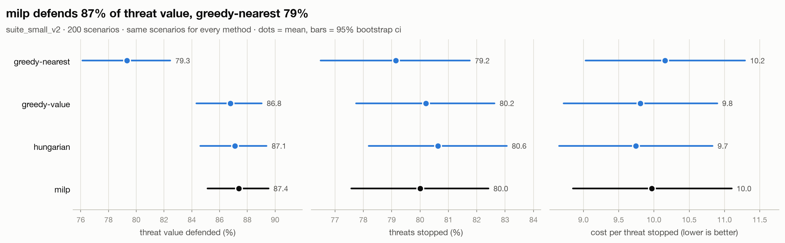

# salvo

[](https://github.com/j0hanj/salvo/actions/workflows/ci.yml)

who shoots what, when a swarm of cheap drones shows up at once and the radios are getting jammed.

salvo is a weapon-target assignment (WTA) testbed. it's a vectorized 2D engagement sim, exact MILP and
auction (CBBA) baselines, and a graph neural net assignment policy trained by imitation learning on
solver-optimal plans. the end state runs that policy decentralized across raspberry pi nodes that
coordinate over UDP while `tc netem` injects packet loss, latency, and burst outages.

## the problem

cheap drones flip the cost math on air defense: the interceptor costs orders of magnitude more than
the thing it's shooting down. so the whole game is allocation. which effector takes which threat,
solved fast, cost-aware, and re-planned every tick as the engagement evolves. jamming makes it worse:
anything that leans on a central node or a clean network degrades fast once links start dropping.

**question:** under increasing message loss, does a learned decentralized policy hold its intercept
rate better than CBBA, the standard consensus-based auction?

**headline metric:** % of threats stopped vs message-loss rate, every method on identical seeded
scenario suites, reported w confidence intervals.

## stack

- **sim:** numpy, struct-of-arrays, deterministic per seed. pro-nav guidance, swept-segment intercept
  checks, probabilistic kills.
- **baselines:** greedy, hungarian, MILP (OR-Tools) as ground truth at small N, CBBA
  ([choi, brunet & how 2009](https://ieeexplore.ieee.org/document/5072249)).
- **learned:** GNN over a threat-effector bipartite graph, behavior cloning from MILP labels w
  DAgger-style relabeling, trained at ~10 threats and evaluated zero-shot at 500+.
- **deployment:** ONNX export, C++20 inference, binary UDP message protocol, one pi per node,
  virtual nodes to scale past the hardware.

## roadmap

- [x] 0. repo + tooling
- [x] 1. sim, scenario generator, versioned eval suites
- [x] 2. baselines + eval harness
- [ ] 3. learned centralized policy + scaling study
- [ ] 4. decentralized in sim: CBBA vs GNN under simulated loss
- [ ] 5. raspberry pi deployment
- [ ] 6. jamming sweeps + write-up

## one engagement

<picture>
  <source media="(prefers-color-scheme: dark)" srcset="docs/figures/engagement_example_dark.png">
  
</picture>

made by `scripts/render_engagement.py` (`make figures`). sim details in [docs/SIM.md](docs/SIM.md).

## baselines (phase 2)

<picture>
  <source media="(prefers-color-scheme: dark)" srcset="docs/figures/compare_suite_small_v2_dark.png">
  
</picture>

<!-- compare:suite_small_v2 -->
| method | threats stopped % | value defended % | Δ stopped vs milp | Δ value vs milp | cost per threat stopped | decision latency ms |
|---|---|---|---|---|---|---|
| greedy-nearest | 79.2 [76.5, 81.8] | 79.3 [76.1, 82.5] | -0.9 [-2.1, 0.4] | -8.1 [-10.6, -5.7] | 10.2 [9.0, 11.3] | 0.015 [0.015, 0.015] |
| greedy-value | 80.2 [77.7, 82.6] | 86.8 [84.3, 89.0] | 0.2 [-0.4, 0.8] | -0.6 [-1.5, 0.2] | 9.8 [8.7, 10.9] | 0.019 [0.019, 0.021] |
| hungarian | 80.6 [78.2, 83.1] | 87.1 [84.6, 89.4] | 0.6 [0.0, 1.3] | -0.3 [-1.4, 0.7] | 9.7 [8.7, 10.8] | 0.024 [0.022, 0.025] |
| milp | 80.0 [77.6, 82.4] | 87.4 [85.1, 89.5] | — | — | 10.0 [8.9, 11.1] | 2.627 [2.564, 2.692] |

`suite_small_v2`, 200 scenarios, every method on the same ones. means w 95% bootstrap cis over scenarios. Δs are paired per scenario, in pct points. latency = mean wall time of ticks that had a real decision. made by `scripts/compare.py` at `69675f4`.
<!-- /compare:suite_small_v2 -->

what this says so far: under saturation everyone stops about the same number of threats, but picking
*which* ones matters. nearest-first defends way less value than anything that looks at threat value.
exact per-tick MILP doesn't beat hungarian, because it's optimal per snapshot, not over the whole
raid (see [docs/FORMULATION.md](docs/FORMULATION.md)). that gap is the opening for a learned policy.

## setup

```
brew install uv   # or see astral.sh/uv
make setup
make test
make lint
make figures   # rebuilds every figure in this readme
```

## scope

everything is abstract. threats and effectors are points w made-up range, speed, and kill-probability
parameters. no real systems, no real specs, nothing export-controlled. an "intercept" is two points
getting within a radius. it's a resource-allocation problem at heart.
