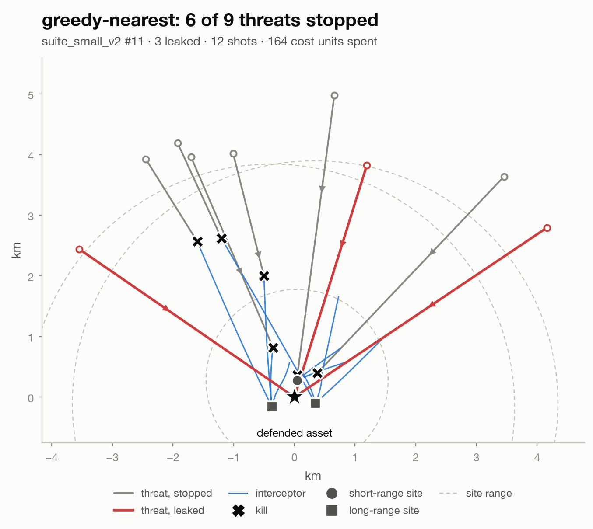
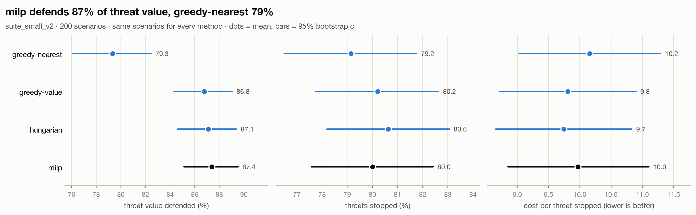
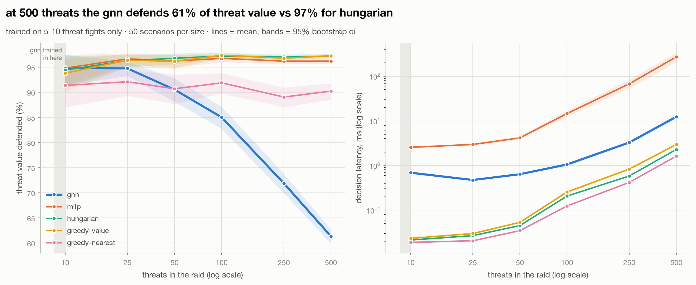
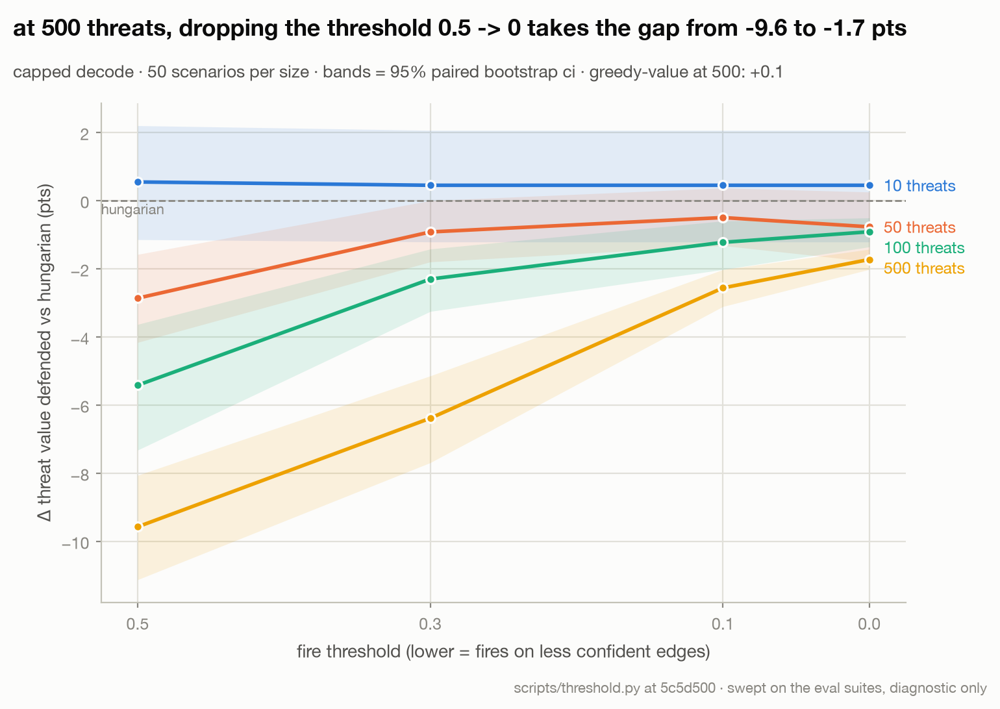
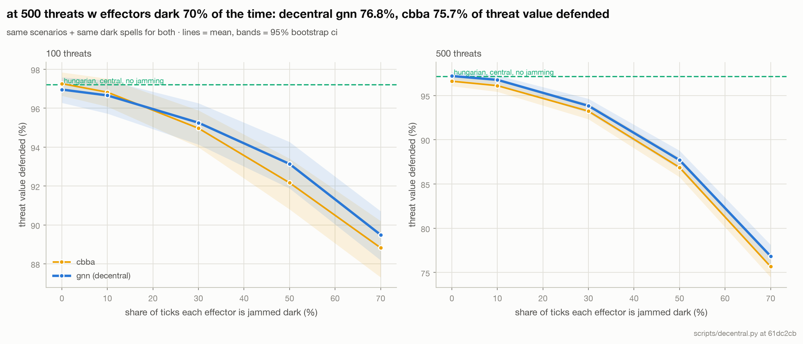

# salvo

[](https://github.com/j0hanj/salvo/actions/workflows/ci.yml)

who shoots what, when a swarm of cheap drones shows up at once and the radios are getting jammed.

salvo is a weapon-target assignment (WTA) testbed. it's a vectorized 2D engagement sim, exact MILP and
auction (CBBA) baselines, and a graph neural net assignment policy trained by imitation learning on
solver-optimal plans. the end state runs that policy decentralized across raspberry pi nodes that
coordinate over UDP while `tc netem` injects packet loss, latency, and burst outages.

## the problem

cheap drones flip the cost math on air defense: the interceptor costs orders of magnitude more than
the thing it's shooting down. so the whole game is allocation. which effector takes which threat,
solved fast, cost-aware, and re-planned every tick as the engagement evolves. jamming makes it worse:
anything that leans on a central node or a clean network degrades fast once links start dropping.

**question:** under increasing message loss, does a learned decentralized policy hold its intercept
rate better than CBBA, the standard consensus-based auction?

**headline metric:** % of threats stopped vs message-loss rate, every method on identical seeded
scenario suites, reported w confidence intervals.

## stack

- **sim:** numpy, struct-of-arrays, deterministic per seed. pro-nav guidance, swept-segment intercept
  checks, probabilistic kills.
- **baselines:** greedy, hungarian, MILP (OR-Tools) as ground truth at small N, CBBA
  ([choi, brunet & how 2009](https://ieeexplore.ieee.org/document/5072249)).
- **learned:** GNN over a threat-effector bipartite graph, behavior cloning from MILP labels w
  DAgger-style relabeling, trained at ~10 threats and evaluated zero-shot at 500+.
- **deployment:** ONNX export, C++20 inference, binary UDP message protocol, one pi per node,
  virtual nodes to scale past the hardware.

## roadmap

- [x] 0. repo + tooling
- [x] 1. sim, scenario generator, versioned eval suites
- [x] 2. baselines + eval harness
- [x] 3. learned centralized policy + scaling study (zero-shot it fell apart; w a fixed decode it ties hungarian up to 500 threats, see below)
- [ ] 4. decentralized in sim: CBBA vs GNN under simulated loss (in progress: cbba, loss models, decentral gnn done)
- [ ] 5. raspberry pi deployment
- [ ] 6. jamming sweeps + write-up

## one engagement

<picture>
  <source media="(prefers-color-scheme: dark)" srcset="docs/figures/engagement_example_dark.png">
  
</picture>

made by `scripts/render_engagement.py` (`make figures`). sim details in [docs/SIM.md](docs/SIM.md).

## baselines (phase 2)

<picture>
  <source media="(prefers-color-scheme: dark)" srcset="docs/figures/compare_suite_small_v2_dark.png">
  
</picture>

<!-- compare:suite_small_v2 -->
| method | threats stopped % | value defended % | Δ stopped vs milp | Δ value vs milp | cost per threat stopped | decision latency ms |
|---|---|---|---|---|---|---|
| greedy-nearest | 79.2 [76.5, 81.8] | 79.3 [76.1, 82.5] | -0.9 [-2.1, 0.4] | -8.1 [-10.6, -5.7] | 10.2 [9.0, 11.3] | 0.015 [0.015, 0.015] |
| greedy-value | 80.2 [77.7, 82.6] | 86.8 [84.3, 89.0] | 0.2 [-0.4, 0.8] | -0.6 [-1.5, 0.2] | 9.8 [8.7, 10.9] | 0.019 [0.019, 0.021] |
| hungarian | 80.6 [78.2, 83.1] | 87.1 [84.6, 89.4] | 0.6 [0.0, 1.3] | -0.3 [-1.4, 0.7] | 9.7 [8.7, 10.8] | 0.024 [0.022, 0.025] |
| milp | 80.0 [77.6, 82.4] | 87.4 [85.1, 89.5] | — | — | 10.0 [8.9, 11.1] | 2.627 [2.564, 2.692] |

`suite_small_v2`, 200 scenarios, every method on the same ones. means w 95% bootstrap cis over scenarios. Δs are paired per scenario, in pct points. latency = mean wall time of ticks that had a real decision. made by `scripts/compare.py` at `69675f4`.
<!-- /compare:suite_small_v2 -->

what this says so far: under saturation everyone stops about the same number of threats, but picking
*which* ones matters. nearest-first defends way less value than anything that looks at threat value.
exact per-tick MILP doesn't beat hungarian, because it's optimal per snapshot, not over the whole
raid (see [docs/FORMULATION.md](docs/FORMULATION.md)). that gap is the opening for a learned policy.

## learned policy + scaling (phase 3)

<picture>
  <source media="(prefers-color-scheme: dark)" srcset="docs/figures/scaling_dark.png">
  
</picture>

GNN trained by imitation (behavior cloning + 3 DAgger rounds) on 5-10 threat fights, then run
zero-shot on 10 to 500. how it works: [docs/LEARNED.md](docs/LEARNED.md).

**it doesn't generalize.** at training size it matches MILP. past that it degrades steadily, down to
61% of threat value at 500 threats vs 97% for hungarian. it isn't under-firing, it's *over*-firing:
at 100 threats it puts 3+ shooters on the same threat on 22% of targeted threats vs 7% for MILP
(`scripts/stacking.py`). likely cause: each effector picks its own best shot, and the only thing
stopping them from all picking the same one is the message passing. mean + max aggregation, picked
so the model wouldn't care about graph size, also can't tell 3 competing shooters from 50. tested
that below, and it's mostly wrong.

latency does scale: about 12 ms per decision at 500 threats vs about 270 ms for MILP. MILP also
slips slightly behind hungarian from 100 threats up (about 1 pt of value at 500).

<details><summary>full scaling table</summary>

<!-- scaling -->
| threats | method | value defended % | Δ value vs hungarian | threats stopped % | decision latency ms |
|---|---|---|---|---|---|
| 10 | greedy-nearest | 91.4 [87.0, 95.1] | -3.0 [-5.5, -1.0] | 92.0 [89.0, 94.8] | 0.02 [0.02, 0.02] |
| 10 | greedy-value | 93.8 [90.1, 96.7] | -0.6 [-1.6, 0.0] | 91.2 [87.8, 94.2] | 0.02 [0.02, 0.03] |
| 10 | hungarian | 94.4 [90.8, 97.1] | — | 91.8 [88.4, 94.8] | 0.02 [0.02, 0.02] |
| 10 | milp | 94.8 [91.3, 97.4] | 0.4 [-1.3, 2.1] | 91.4 [87.8, 94.6] | 2.56 [2.48, 2.64] |
| 10 | gnn | 94.8 [91.3, 97.4] | 0.4 [-1.2, 2.1] | 91.0 [87.6, 94.2] | 0.69 [0.64, 0.75] |
| 25 | greedy-nearest | 92.1 [89.3, 94.5] | -4.2 [-6.3, -2.3] | 92.2 [89.8, 94.3] | 0.02 [0.02, 0.02] |
| 25 | greedy-value | 96.4 [95.0, 97.5] | 0.1 [-0.5, 0.6] | 91.8 [89.4, 94.0] | 0.03 [0.03, 0.03] |
| 25 | hungarian | 96.3 [95.0, 97.4] | — | 91.4 [88.9, 93.8] | 0.03 [0.03, 0.03] |
| 25 | milp | 96.6 [95.4, 97.7] | 0.4 [-0.5, 1.2] | 91.6 [89.3, 93.8] | 2.97 [2.80, 3.18] |
| 25 | gnn | 94.7 [93.2, 96.1] | -1.6 [-2.5, -0.7] | 87.3 [84.6, 89.9] | 0.47 [0.46, 0.49] |
| 50 | greedy-nearest | 90.7 [87.6, 93.5] | -6.1 [-8.6, -3.7] | 90.0 [86.9, 92.7] | 0.03 [0.03, 0.04] |
| 50 | greedy-value | 96.1 [94.7, 97.3] | -0.6 [-1.8, 0.3] | 91.0 [88.5, 93.3] | 0.05 [0.05, 0.06] |
| 50 | hungarian | 96.7 [95.6, 97.7] | — | 91.6 [89.1, 93.7] | 0.05 [0.04, 0.05] |
| 50 | milp | 96.2 [94.9, 97.3] | -0.5 [-1.3, 0.2] | 89.0 [86.1, 91.6] | 4.17 [3.88, 4.49] |
| 50 | gnn | 90.5 [88.1, 92.7] | -6.2 [-8.3, -4.3] | 76.6 [72.3, 80.6] | 0.64 [0.62, 0.66] |
| 100 | greedy-nearest | 91.9 [89.7, 93.8] | -5.3 [-7.1, -3.7] | 91.1 [89.1, 92.9] | 0.12 [0.12, 0.13] |
| 100 | greedy-value | 97.3 [96.8, 97.9] | 0.1 [-0.2, 0.6] | 92.2 [90.6, 93.7] | 0.25 [0.24, 0.27] |
| 100 | hungarian | 97.2 [96.5, 97.8] | — | 92.1 [90.4, 93.7] | 0.21 [0.20, 0.21] |
| 100 | milp | 96.7 [96.0, 97.4] | -0.5 [-0.8, -0.1] | 89.1 [87.3, 90.9] | 14.63 [12.37, 17.17] |
| 100 | gnn | 85.0 [82.7, 87.1] | -12.2 [-14.2, -10.3] | 63.3 [60.0, 66.5] | 1.05 [0.98, 1.14] |
| 250 | greedy-nearest | 89.0 [87.1, 90.9] | -8.0 [-9.7, -6.4] | 89.0 [87.2, 90.7] | 0.42 [0.41, 0.42] |
| 250 | greedy-value | 96.8 [96.3, 97.2] | -0.3 [-0.6, 0.0] | 90.1 [88.6, 91.6] | 0.83 [0.79, 0.88] |
| 250 | hungarian | 97.1 [96.6, 97.5] | — | 90.6 [89.0, 92.1] | 0.58 [0.58, 0.59] |
| 250 | milp | 96.2 [95.6, 96.7] | -0.9 [-1.2, -0.6] | 85.9 [84.1, 87.7] | 67.75 [53.73, 83.73] |
| 250 | gnn | 71.9 [69.9, 73.8] | -25.2 [-27.0, -23.4] | 43.2 [41.1, 45.2] | 3.29 [3.05, 3.53] |
| 500 | greedy-nearest | 90.2 [88.5, 91.8] | -7.0 [-8.4, -5.6] | 90.0 [88.3, 91.6] | 1.62 [1.61, 1.64] |
| 500 | greedy-value | 97.2 [96.8, 97.6] | 0.1 [-0.1, 0.2] | 91.3 [89.8, 92.7] | 2.96 [2.83, 3.09] |
| 500 | hungarian | 97.2 [96.8, 97.6] | — | 91.2 [89.7, 92.7] | 2.29 [2.28, 2.31] |
| 500 | milp | 96.2 [95.7, 96.7] | -1.0 [-1.2, -0.7] | 86.4 [84.8, 88.1] | 272.43 [209.42, 341.30] |
| 500 | gnn | 61.3 [59.9, 62.7] | -35.8 [-37.1, -34.7] | 31.4 [30.2, 32.6] | 12.40 [11.15, 13.73] |

`suite_scale_n*_v1`, 50 scenarios per size, same scenarios for every method. 95% bootstrap cis, Δ paired per scenario. milp solves are capped at 5s each. gnn trained on 5-10 threats only (`scripts/train.py` at `8bb2ef4`). made by `scripts/scaling.py` at `af0bf0b`.
<!-- /scaling -->

</details>

### what's actually causing it (ablation)

2x2: {plain, + a log-degree channel so nodes can count competing shooters} x {argmax decode where
every effector picks on its own, capped decode that walks shots most-confident-first and stops
adding shooters once a threat's covered}. degree model trained w the same recipe + `--degree`.

at 500 threats: the degree channel barely moves it (61.3 -> 64.4% of value) and it still stacks 3+
shooters on 37% of targeted threats. capped decode gets it to 87.6% w zero stacking. so most of the
damage is independent per-effector decoding, not the aggregation. combining both is worse than
capped alone (81.7%). and even w zero stacking it only stops 65% of threats at 500 vs 91% for
hungarian, so there's a second failure mode left (next section).

<details><summary>ablation table</summary>

<!-- ablation -->
| threats | method | value defended % | Δ value vs hungarian | threats stopped % | targeted threats w 3+ shooters % | decision latency ms |
|---|---|---|---|---|---|---|
| 10 | hungarian | 94.4 [90.8, 97.1] | — | 91.8 [88.4, 94.8] | 0.0 [0.0, 0.0] | 0.02 [0.02, 0.02] |
| 10 | milp | 94.8 [91.3, 97.4] | 0.4 [-1.3, 2.1] | 91.4 [87.8, 94.6] | 0.5 [0.0, 1.2] | 2.44 [2.30, 2.64] |
| 10 | gnn | 94.8 [91.3, 97.4] | 0.4 [-1.2, 2.1] | 91.0 [87.6, 94.2] | 0.5 [0.0, 1.2] | 0.62 [0.47, 0.77] |
| 10 | gnn capped | 94.9 [91.4, 97.5] | 0.5 [-1.2, 2.2] | 91.4 [88.0, 94.4] | 0.0 [0.0, 0.0] | 0.43 [0.42, 0.44] |
| 10 | gnn+deg | 94.9 [91.5, 97.5] | 0.5 [-1.0, 2.1] | 91.4 [88.0, 94.4] | 0.5 [0.0, 1.2] | 0.49 [0.47, 0.52] |
| 10 | gnn+deg capped | 95.4 [92.0, 97.8] | 1.0 [-0.1, 2.3] | 92.0 [88.6, 95.0] | 0.0 [0.0, 0.0] | 0.43 [0.43, 0.44] |
| 50 | hungarian | 96.7 [95.6, 97.7] | — | 91.6 [89.1, 93.7] | 0.0 [0.0, 0.0] | 0.04 [0.04, 0.04] |
| 50 | milp | 96.2 [94.9, 97.3] | -0.5 [-1.3, 0.2] | 89.0 [86.1, 91.6] | 5.0 [4.2, 5.8] | 3.62 [3.37, 3.90] |
| 50 | gnn | 90.5 [88.1, 92.7] | -6.2 [-8.3, -4.3] | 76.6 [72.3, 80.6] | 12.4 [10.9, 13.9] | 0.54 [0.53, 0.55] |
| 50 | gnn capped | 93.9 [92.2, 95.5] | -2.9 [-4.2, -1.6] | 83.5 [79.8, 87.0] | 0.0 [0.0, 0.0] | 0.52 [0.51, 0.53] |
| 50 | gnn+deg | 91.5 [89.4, 93.4] | -5.2 [-6.9, -3.8] | 77.9 [74.2, 81.5] | 11.8 [10.6, 13.1] | 0.79 [0.66, 0.95] |
| 50 | gnn+deg capped | 93.4 [91.2, 95.3] | -3.3 [-5.2, -1.7] | 83.7 [80.1, 87.2] | 0.0 [0.0, 0.0] | 0.83 [0.80, 0.86] |
| 100 | hungarian | 97.2 [96.5, 97.8] | — | 92.1 [90.4, 93.7] | 0.0 [0.0, 0.0] | 0.12 [0.12, 0.13] |
| 100 | milp | 96.7 [96.0, 97.4] | -0.5 [-0.8, -0.1] | 89.1 [87.3, 90.9] | 6.5 [5.8, 7.2] | 12.41 [10.40, 14.71] |
| 100 | gnn | 85.0 [82.7, 87.1] | -12.2 [-14.2, -10.3] | 63.3 [60.0, 66.5] | 22.3 [21.0, 23.6] | 1.26 [1.18, 1.34] |
| 100 | gnn capped | 91.8 [89.6, 93.9] | -5.4 [-7.3, -3.6] | 78.7 [74.7, 82.7] | 0.0 [0.0, 0.0] | 0.86 [0.81, 0.91] |
| 100 | gnn+deg | 84.6 [82.6, 86.5] | -12.6 [-14.2, -11.0] | 64.1 [61.7, 66.5] | 18.2 [17.3, 19.2] | 0.76 [0.73, 0.78] |
| 100 | gnn+deg capped | 91.1 [89.1, 92.9] | -6.1 [-7.6, -4.7] | 78.5 [75.3, 81.6] | 0.0 [0.0, 0.0] | 0.70 [0.68, 0.72] |
| 500 | hungarian | 97.2 [96.8, 97.6] | — | 91.2 [89.7, 92.7] | 0.0 [0.0, 0.0] | 2.00 [1.99, 2.02] |
| 500 | gnn | 61.3 [59.9, 62.7] | -35.8 [-37.1, -34.7] | 31.4 [30.2, 32.6] | 48.6 [47.5, 49.6] | 10.41 [9.46, 11.41] |
| 500 | gnn capped | 87.6 [85.8, 89.3] | -9.6 [-11.1, -8.1] | 65.2 [62.2, 68.3] | 0.0 [0.0, 0.0] | 13.17 [11.76, 14.64] |
| 500 | gnn+deg | 64.4 [62.4, 66.3] | -32.8 [-34.4, -31.1] | 36.8 [35.0, 38.6] | 36.5 [35.4, 37.6] | 12.55 [11.30, 13.86] |
| 500 | gnn+deg capped | 81.7 [79.1, 84.2] | -15.5 [-17.8, -13.2] | 61.2 [57.4, 64.9] | 0.0 [0.0, 0.0] | 12.18 [10.88, 13.50] |

`suite_scale_n*_v1`, 50 scenarios per size, same scenarios for every method. 95% bootstrap cis, Δ paired per scenario. 3+ shooters = share of (tick, targeted threat) pairs w 3 or more interceptors launched at it, averaged per scenario. models from `scripts/train.py` at `8bb2ef4` (plain) and `cdf40a9` (+deg). made by `scripts/ablation.py` at `cdf40a9`.
<!-- /ablation -->

</details>

### the leftover gap is mostly the fire threshold

capped decode only fires on edges scoring >= 0.5. the model's scores shrink as the graph grows:
median best-edge score per free effector is 1.00 at 10 threats and 0.64 at 500, where 43% of free
effectors don't have a single edge above 0.5. at 500, 72% of free effectors sit idle while a
threat they could reach is still uncovered (`scripts/confidence.py`).

sweeping the threshold (`scripts/threshold.py`): at 500 threats, value defended goes 87.6 (0.5) ->
90.8 (0.3) -> 94.6 (0.1) -> 95.4 (0.0), threats stopped 65.2 -> 84.9. at 10 threats it doesn't
matter. but at threshold 0 capped decode is just "rank edges by the model's score, fill greedily",
and a hand-written ranking does that better: greedy-value gets 97.2 at 500 w 1.00x hungarian's
shots, the gnn 95.4 w 1.16x. the threshold was swept on the eval suites, so this is a diagnostic,
not a tuned number.

<picture>
  <source media="(prefers-color-scheme: dark)" srcset="docs/figures/threshold_dark.png">
  
</picture>

<details><summary>confidence + threshold tables</summary>

<!-- confidence -->
| threats | best edge score, median [p10, p90] | effectors w best score < 0.5 % | idle w an uncovered legal target % | fired % |
|---|---|---|---|---|
| 10 | 1.00 [0.99, 1.00] | 0.4 [0.0, 1.0] | 0.4 [0.0, 1.0] | 98.5 [97.7, 99.3] |
| 50 | 0.98 [0.27, 1.00] | 21.2 [16.2, 26.5] | 26.8 [21.3, 32.5] | 65.3 [60.0, 70.5] |
| 100 | 0.61 [0.20, 1.00] | 40.6 [36.5, 44.6] | 54.1 [50.2, 57.9] | 37.6 [34.4, 41.1] |
| 500 | 0.64 [0.16, 1.00] | 42.6 [40.4, 44.9] | 71.8 [70.3, 73.3] | 18.1 [17.0, 19.2] |

`suite_scale_n*_v1`, 50 scenarios per size, gnn w capped decode at threshold 0.5. one row = every (tick, free effector w at least one legal shot). idle w an uncovered legal target = didn't fire even though some threat it could reach was still below the coverage floor after decode, so only the threshold held it back. 95% bootstrap cis over scenarios. model `20261029-213442-train`. made by `scripts/confidence.py` at `ec2f8cd`.
<!-- /confidence -->

<!-- threshold -->
| threats | method | value defended % | Δ value vs hungarian | threats stopped % | shots vs hungarian | targeted threats w 3+ shooters % |
|---|---|---|---|---|---|---|
| 10 | hungarian | 94.4 [90.8, 97.1] | — | 91.8 [88.4, 94.8] | 1.00 [1.00, 1.00]x | 0.0 [0.0, 0.0] |
| 10 | greedy-value | 93.8 [90.1, 96.7] | -0.6 [-1.6, 0.0] | 91.2 [87.8, 94.2] | 1.00 [0.99, 1.00]x | 0.0 [0.0, 0.0] |
| 10 | gnn capped @0.5 | 94.9 [91.4, 97.5] | 0.5 [-1.2, 2.2] | 91.4 [88.0, 94.4] | 1.04 [1.02, 1.07]x | 0.0 [0.0, 0.0] |
| 10 | gnn capped @0.3 | 94.8 [91.3, 97.4] | 0.4 [-1.2, 2.1] | 91.2 [87.8, 94.2] | 1.05 [1.03, 1.07]x | 0.0 [0.0, 0.0] |
| 10 | gnn capped @0.1 | 94.8 [91.3, 97.4] | 0.4 [-1.2, 2.1] | 91.2 [87.8, 94.2] | 1.05 [1.03, 1.07]x | 0.0 [0.0, 0.0] |
| 10 | gnn capped @0.0 | 94.8 [91.3, 97.4] | 0.4 [-1.2, 2.1] | 91.2 [87.8, 94.2] | 1.05 [1.03, 1.07]x | 0.0 [0.0, 0.0] |
| 50 | hungarian | 96.7 [95.6, 97.7] | — | 91.6 [89.1, 93.7] | 1.00 [1.00, 1.00]x | 0.0 [0.0, 0.0] |
| 50 | greedy-value | 96.1 [94.7, 97.3] | -0.6 [-1.8, 0.3] | 91.0 [88.5, 93.3] | 1.00 [0.99, 1.01]x | 0.0 [0.0, 0.0] |
| 50 | gnn capped @0.5 | 93.9 [92.2, 95.5] | -2.9 [-4.2, -1.6] | 83.5 [79.8, 87.0] | 1.08 [1.05, 1.12]x | 0.0 [0.0, 0.0] |
| 50 | gnn capped @0.3 | 95.8 [94.5, 96.9] | -0.9 [-1.8, -0.0] | 86.6 [83.6, 89.3] | 1.12 [1.10, 1.14]x | 0.0 [0.0, 0.0] |
| 50 | gnn capped @0.1 | 96.2 [95.1, 97.3] | -0.5 [-1.3, 0.4] | 87.7 [84.8, 90.4] | 1.13 [1.11, 1.16]x | 0.0 [0.0, 0.0] |
| 50 | gnn capped @0.0 | 96.0 [94.8, 97.0] | -0.8 [-1.8, 0.2] | 87.7 [85.0, 90.2] | 1.13 [1.11, 1.15]x | 0.0 [0.0, 0.0] |
| 100 | hungarian | 97.2 [96.5, 97.8] | — | 92.1 [90.4, 93.7] | 1.00 [1.00, 1.00]x | 0.0 [0.0, 0.0] |
| 100 | greedy-value | 97.3 [96.8, 97.9] | 0.1 [-0.2, 0.6] | 92.2 [90.6, 93.7] | 1.00 [0.99, 1.00]x | 0.0 [0.0, 0.0] |
| 100 | gnn capped @0.5 | 91.8 [89.6, 93.9] | -5.4 [-7.3, -3.6] | 78.7 [74.7, 82.7] | 1.04 [0.99, 1.08]x | 0.0 [0.0, 0.0] |
| 100 | gnn capped @0.3 | 94.9 [93.5, 96.2] | -2.3 [-3.3, -1.4] | 84.8 [81.8, 87.7] | 1.11 [1.08, 1.14]x | 0.0 [0.0, 0.0] |
| 100 | gnn capped @0.1 | 96.0 [95.0, 96.9] | -1.2 [-2.0, -0.6] | 87.7 [85.7, 89.6] | 1.14 [1.12, 1.15]x | 0.0 [0.0, 0.0] |
| 100 | gnn capped @0.0 | 96.3 [95.4, 97.1] | -0.9 [-1.4, -0.5] | 88.2 [86.3, 90.0] | 1.14 [1.12, 1.16]x | 0.0 [0.0, 0.0] |
| 500 | hungarian | 97.2 [96.8, 97.6] | — | 91.2 [89.7, 92.7] | 1.00 [1.00, 1.00]x | 0.0 [0.0, 0.0] |
| 500 | greedy-value | 97.2 [96.8, 97.6] | 0.1 [-0.1, 0.2] | 91.3 [89.8, 92.7] | 1.00 [1.00, 1.00]x | 0.0 [0.0, 0.0] |
| 500 | gnn capped @0.5 | 87.6 [85.8, 89.3] | -9.6 [-11.1, -8.1] | 65.2 [62.2, 68.3] | 0.91 [0.87, 0.94]x | 0.0 [0.0, 0.0] |
| 500 | gnn capped @0.3 | 90.8 [89.2, 92.2] | -6.4 [-7.7, -5.1] | 70.9 [67.8, 73.8] | 0.99 [0.96, 1.02]x | 0.0 [0.0, 0.0] |
| 500 | gnn capped @0.1 | 94.6 [93.8, 95.4] | -2.6 [-3.1, -2.0] | 80.0 [77.9, 82.0] | 1.11 [1.09, 1.13]x | 0.0 [0.0, 0.0] |
| 500 | gnn capped @0.0 | 95.4 [94.8, 96.1] | -1.7 [-2.0, -1.4] | 84.9 [83.0, 86.8] | 1.16 [1.15, 1.18]x | 0.0 [0.0, 0.0] |

`suite_scale_n*_v1`, 50 scenarios per size, same scenarios for every method. gnn w capped decode at each fire threshold. shots vs hungarian = interceptors launched per scenario / hungarian's on the same scenario. 95% bootstrap cis, Δ paired per scenario. threshold swept on the eval suites, so read it as a diagnostic, not a tuned result. model from `scripts/train.py` at `8bb2ef4`. made by `scripts/threshold.py` at `5c5d500`.
<!-- /threshold -->

</details>

### training on bigger fights fixes calibration only up to the sizes it saw

same recipe, trained on 5-10 + 25 + 50 threat fights (`scripts/train.py --suites suite_train_v1
suite_train_n25_v1 suite_train_n50_v1`), same threshold sweep (`scripts/threshold.py --tag
mixed`). at default threshold 0.5, Δ value vs hungarian at 100 threats goes -5.4 (5-10 only) ->
-2.3 (mixed), and from 50 down the threshold barely matters anymore. at 500, past anything it
trained on, it's no better: -11.4 [-13.3, -9.6] at 0.5 and -1.9 [-2.3, -1.6] at 0.0, vs -9.6 and
-1.7 for the 5-10 model. greedy-value is still +0.1 there.

<details><summary>mixed-size threshold table</summary>

<!-- threshold_mixed -->
| threats | method | value defended % | Δ value vs hungarian | threats stopped % | shots vs hungarian | targeted threats w 3+ shooters % |
|---|---|---|---|---|---|---|
| 10 | hungarian | 94.4 [90.8, 97.1] | — | 91.8 [88.4, 94.8] | 1.00 [1.00, 1.00]x | 0.0 [0.0, 0.0] |
| 10 | greedy-value | 93.8 [90.1, 96.7] | -0.6 [-1.6, 0.0] | 91.2 [87.8, 94.2] | 1.00 [0.99, 1.00]x | 0.0 [0.0, 0.0] |
| 10 | gnn capped @0.5 | 94.6 [91.2, 97.2] | 0.2 [-1.3, 1.8] | 90.8 [87.4, 93.8] | 1.04 [1.02, 1.07]x | 0.0 [0.0, 0.0] |
| 10 | gnn capped @0.3 | 94.6 [91.2, 97.2] | 0.2 [-1.3, 1.8] | 90.8 [87.4, 93.8] | 1.04 [1.02, 1.07]x | 0.0 [0.0, 0.0] |
| 10 | gnn capped @0.1 | 94.6 [91.2, 97.2] | 0.2 [-1.3, 1.8] | 90.8 [87.4, 93.8] | 1.04 [1.02, 1.07]x | 0.0 [0.0, 0.0] |
| 10 | gnn capped @0.0 | 94.6 [91.2, 97.2] | 0.2 [-1.3, 1.8] | 90.8 [87.4, 93.8] | 1.04 [1.02, 1.07]x | 0.0 [0.0, 0.0] |
| 50 | hungarian | 96.7 [95.6, 97.7] | — | 91.6 [89.1, 93.7] | 1.00 [1.00, 1.00]x | 0.0 [0.0, 0.0] |
| 50 | greedy-value | 96.1 [94.7, 97.3] | -0.6 [-1.8, 0.3] | 91.0 [88.5, 93.3] | 1.00 [0.99, 1.01]x | 0.0 [0.0, 0.0] |
| 50 | gnn capped @0.5 | 96.0 [94.9, 97.0] | -0.7 [-1.6, 0.2] | 87.3 [84.3, 90.0] | 1.12 [1.10, 1.14]x | 0.0 [0.0, 0.0] |
| 50 | gnn capped @0.3 | 96.2 [95.1, 97.2] | -0.5 [-1.4, 0.4] | 87.8 [84.9, 90.4] | 1.13 [1.11, 1.15]x | 0.0 [0.0, 0.0] |
| 50 | gnn capped @0.1 | 96.3 [95.2, 97.3] | -0.4 [-1.3, 0.5] | 87.8 [84.8, 90.5] | 1.13 [1.11, 1.15]x | 0.0 [0.0, 0.0] |
| 50 | gnn capped @0.0 | 96.2 [95.0, 97.3] | -0.5 [-1.5, 0.5] | 87.7 [84.7, 90.4] | 1.13 [1.11, 1.15]x | 0.0 [0.0, 0.0] |
| 100 | hungarian | 97.2 [96.5, 97.8] | — | 92.1 [90.4, 93.7] | 1.00 [1.00, 1.00]x | 0.0 [0.0, 0.0] |
| 100 | greedy-value | 97.3 [96.8, 97.9] | 0.1 [-0.2, 0.6] | 92.2 [90.6, 93.7] | 1.00 [0.99, 1.00]x | 0.0 [0.0, 0.0] |
| 100 | gnn capped @0.5 | 94.9 [93.7, 96.1] | -2.3 [-3.1, -1.5] | 84.8 [82.0, 87.5] | 1.08 [1.05, 1.11]x | 0.0 [0.0, 0.0] |
| 100 | gnn capped @0.3 | 96.3 [95.3, 97.1] | -0.9 [-1.5, -0.4] | 87.9 [85.7, 90.0] | 1.13 [1.12, 1.14]x | 0.0 [0.0, 0.0] |
| 100 | gnn capped @0.1 | 96.3 [95.4, 97.1] | -0.9 [-1.4, -0.5] | 88.1 [86.1, 90.1] | 1.13 [1.12, 1.15]x | 0.0 [0.0, 0.0] |
| 100 | gnn capped @0.0 | 96.4 [95.6, 97.2] | -0.8 [-1.2, -0.4] | 87.7 [85.5, 89.7] | 1.13 [1.12, 1.15]x | 0.0 [0.0, 0.0] |
| 500 | hungarian | 97.2 [96.8, 97.6] | — | 91.2 [89.7, 92.7] | 1.00 [1.00, 1.00]x | 0.0 [0.0, 0.0] |
| 500 | greedy-value | 97.2 [96.8, 97.6] | 0.1 [-0.1, 0.2] | 91.3 [89.8, 92.7] | 1.00 [1.00, 1.00]x | 0.0 [0.0, 0.0] |
| 500 | gnn capped @0.5 | 85.8 [83.6, 87.8] | -11.4 [-13.3, -9.6] | 63.8 [60.3, 67.1] | 0.78 [0.75, 0.82]x | 0.0 [0.0, 0.0] |
| 500 | gnn capped @0.3 | 93.7 [92.7, 94.7] | -3.5 [-4.1, -2.8] | 80.0 [77.4, 82.6] | 1.08 [1.05, 1.10]x | 0.0 [0.0, 0.0] |
| 500 | gnn capped @0.1 | 95.2 [94.5, 95.9] | -1.9 [-2.3, -1.6] | 83.8 [81.7, 85.9] | 1.16 [1.15, 1.18]x | 0.0 [0.0, 0.0] |
| 500 | gnn capped @0.0 | 95.2 [94.6, 95.9] | -1.9 [-2.3, -1.6] | 84.0 [81.9, 86.1] | 1.17 [1.15, 1.18]x | 0.0 [0.0, 0.0] |

`suite_scale_n*_v1`, 50 scenarios per size, same scenarios for every method. gnn w capped decode at each fire threshold. shots vs hungarian = interceptors launched per scenario / hungarian's on the same scenario. 95% bootstrap cis, Δ paired per scenario. threshold swept on the eval suites, so read it as a diagnostic, not a tuned result. model `20261106-141850-train`, trained on suite_train_v1, suite_train_n25_v1, suite_train_n50_v1 by `scripts/train.py` at `e54b5de`. made by `scripts/threshold.py` at `e64056c`.
<!-- /threshold_mixed -->

</details>

### a per-effector ranking loss makes the threshold irrelevant, and the policy worse

swapped per-edge bce for a softmax over each effector's legal edges + a fixed "hold" logit
(`scripts/train.py --loss listwise`, 5-10 threat fights only, otherwise the same recipe). the
threshold stops mattering: every row from 0.5 to 0.0 is identical at every size, because almost
every legal edge now scores above hold. but value defended drops everywhere, including at
training size: Δ vs hungarian -7.1 [-10.4, -4.1] at 10 threats, -14.5 [-16.4, -12.7] at 500
(`scripts/threshold.py --tag listwise`). it stops plenty of threats (83.0% at 500) but not the
valuable ones. likely why: the softmax only ranks edges within one effector, and capped decode
compares scores across effectors to decide who shoots first, which this loss never trains.

<details><summary>listwise threshold table</summary>

<!-- threshold_listwise -->
| threats | method | value defended % | Δ value vs hungarian | threats stopped % | shots vs hungarian | targeted threats w 3+ shooters % |
|---|---|---|---|---|---|---|
| 10 | hungarian | 94.4 [90.8, 97.1] | — | 91.8 [88.4, 94.8] | 1.00 [1.00, 1.00]x | 0.0 [0.0, 0.0] |
| 10 | greedy-value | 93.8 [90.1, 96.7] | -0.6 [-1.6, 0.0] | 91.2 [87.8, 94.2] | 1.00 [0.99, 1.00]x | 0.0 [0.0, 0.0] |
| 10 | gnn capped @0.5 | 87.3 [82.5, 91.5] | -7.1 [-10.4, -4.1] | 89.4 [86.2, 92.2] | 1.07 [1.04, 1.10]x | 0.0 [0.0, 0.0] |
| 10 | gnn capped @0.3 | 87.3 [82.5, 91.5] | -7.1 [-10.4, -4.1] | 89.4 [86.2, 92.2] | 1.07 [1.04, 1.10]x | 0.0 [0.0, 0.0] |
| 10 | gnn capped @0.1 | 87.3 [82.5, 91.5] | -7.1 [-10.4, -4.1] | 89.4 [86.2, 92.2] | 1.07 [1.04, 1.10]x | 0.0 [0.0, 0.0] |
| 10 | gnn capped @0.0 | 87.3 [82.5, 91.5] | -7.1 [-10.4, -4.1] | 89.4 [86.2, 92.2] | 1.07 [1.04, 1.10]x | 0.0 [0.0, 0.0] |
| 50 | hungarian | 96.7 [95.6, 97.7] | — | 91.6 [89.1, 93.7] | 1.00 [1.00, 1.00]x | 0.0 [0.0, 0.0] |
| 50 | greedy-value | 96.1 [94.7, 97.3] | -0.6 [-1.8, 0.3] | 91.0 [88.5, 93.3] | 1.00 [0.99, 1.01]x | 0.0 [0.0, 0.0] |
| 50 | gnn capped @0.5 | 84.7 [80.8, 88.4] | -12.0 [-15.6, -8.7] | 86.0 [82.9, 88.8] | 1.15 [1.12, 1.17]x | 0.0 [0.0, 0.0] |
| 50 | gnn capped @0.3 | 84.7 [80.8, 88.4] | -12.0 [-15.6, -8.7] | 86.0 [82.9, 88.8] | 1.15 [1.12, 1.17]x | 0.0 [0.0, 0.0] |
| 50 | gnn capped @0.1 | 84.7 [80.8, 88.4] | -12.0 [-15.6, -8.7] | 86.0 [82.9, 88.8] | 1.15 [1.12, 1.17]x | 0.0 [0.0, 0.0] |
| 50 | gnn capped @0.0 | 84.7 [80.8, 88.4] | -12.0 [-15.6, -8.7] | 86.0 [82.9, 88.8] | 1.15 [1.12, 1.17]x | 0.0 [0.0, 0.0] |
| 100 | hungarian | 97.2 [96.5, 97.8] | — | 92.1 [90.4, 93.7] | 1.00 [1.00, 1.00]x | 0.0 [0.0, 0.0] |
| 100 | greedy-value | 97.3 [96.8, 97.9] | 0.1 [-0.2, 0.6] | 92.2 [90.6, 93.7] | 1.00 [0.99, 1.00]x | 0.0 [0.0, 0.0] |
| 100 | gnn capped @0.5 | 86.5 [83.9, 88.9] | -10.7 [-12.9, -8.7] | 86.5 [84.5, 88.4] | 1.16 [1.15, 1.18]x | 0.0 [0.0, 0.0] |
| 100 | gnn capped @0.3 | 86.5 [83.9, 88.9] | -10.7 [-12.9, -8.7] | 86.5 [84.5, 88.4] | 1.16 [1.15, 1.18]x | 0.0 [0.0, 0.0] |
| 100 | gnn capped @0.1 | 86.5 [83.9, 88.9] | -10.7 [-12.9, -8.7] | 86.5 [84.5, 88.4] | 1.16 [1.15, 1.18]x | 0.0 [0.0, 0.0] |
| 100 | gnn capped @0.0 | 86.5 [83.9, 88.9] | -10.7 [-12.9, -8.7] | 86.5 [84.5, 88.4] | 1.16 [1.15, 1.18]x | 0.0 [0.0, 0.0] |
| 500 | hungarian | 97.2 [96.8, 97.6] | — | 91.2 [89.7, 92.7] | 1.00 [1.00, 1.00]x | 0.0 [0.0, 0.0] |
| 500 | greedy-value | 97.2 [96.8, 97.6] | 0.1 [-0.1, 0.2] | 91.3 [89.8, 92.7] | 1.00 [1.00, 1.00]x | 0.0 [0.0, 0.0] |
| 500 | gnn capped @0.5 | 82.6 [80.5, 84.8] | -14.5 [-16.4, -12.7] | 83.0 [80.9, 85.1] | 1.18 [1.16, 1.19]x | 0.0 [0.0, 0.0] |
| 500 | gnn capped @0.3 | 82.6 [80.5, 84.8] | -14.5 [-16.4, -12.7] | 83.0 [80.9, 85.1] | 1.18 [1.16, 1.19]x | 0.0 [0.0, 0.0] |
| 500 | gnn capped @0.1 | 82.6 [80.5, 84.8] | -14.5 [-16.4, -12.7] | 83.0 [80.9, 85.1] | 1.18 [1.16, 1.19]x | 0.0 [0.0, 0.0] |
| 500 | gnn capped @0.0 | 82.6 [80.5, 84.8] | -14.5 [-16.4, -12.7] | 83.0 [80.9, 85.1] | 1.18 [1.16, 1.19]x | 0.0 [0.0, 0.0] |

`suite_scale_n*_v1`, 50 scenarios per size, same scenarios for every method. gnn w capped decode at each fire threshold. shots vs hungarian = interceptors launched per scenario / hungarian's on the same scenario. 95% bootstrap cis, Δ paired per scenario. threshold swept on the eval suites, so read it as a diagnostic, not a tuned result. model `20261109-125935-train`, trained on suite_train_v1 by `scripts/train.py` at `3540f0e`. made by `scripts/threshold.py` at `3540f0e`.
<!-- /threshold_listwise -->

</details>

### the last gap was the decode putting two shooters on a threat

capped decode keeps adding shooters until a threat's chance of surviving them all is <= 0.1. a
0.7 short-range shooter alone leaves 0.3, so it usually sends two, which is where the extra 16%
of shots at 500 went. raising that floor to 0.35 (`scripts/threshold.py --thresholds 0 --floors
0.1 0.35 0.5 --tag floor`, 5-10 threat model, threshold 0): Δ value vs hungarian at 500 goes -1.7
[-2.0, -1.4] -> 0.0 [-0.2, 0.3], threats stopped 84.9 -> 91.8, shots 1.16x -> 1.00x. at 10, 50,
100 it's within the ci of hungarian too. 0.35 and 0.5 give identical rows.

what this does and doesn't show: any floor between 0.3 and 0.7 means "one shooter per threat per
tick" for these effector types, which is the same structure hungarian and greedy-value already
have. so the gnn isn't beating them, it's supplying an ordering that's as good as theirs once the
decode stops it from doubling up. it's also picked on the eval suites. and on one cpu it's still
slower than hungarian at 500 (latency columns above). the case for it is phase 4, where there's
no central solver to run hungarian.

<details><summary>survival floor table</summary>

<!-- threshold_floor -->
| threats | method | value defended % | Δ value vs hungarian | threats stopped % | shots vs hungarian | targeted threats w 3+ shooters % |
|---|---|---|---|---|---|---|
| 10 | hungarian | 94.4 [90.8, 97.1] | — | 91.8 [88.4, 94.8] | 1.00 [1.00, 1.00]x | 0.0 [0.0, 0.0] |
| 10 | greedy-value | 93.8 [90.1, 96.7] | -0.6 [-1.6, 0.0] | 91.2 [87.8, 94.2] | 1.00 [0.99, 1.00]x | 0.0 [0.0, 0.0] |
| 10 | gnn capped @0.0 floor 0.1 | 94.8 [91.3, 97.4] | 0.4 [-1.2, 2.1] | 91.2 [87.8, 94.2] | 1.05 [1.03, 1.07]x | 0.0 [0.0, 0.0] |
| 10 | gnn capped @0.0 floor 0.35 | 95.0 [91.4, 97.7] | 0.6 [-0.3, 1.6] | 92.4 [89.2, 95.4] | 1.00 [0.99, 1.01]x | 0.0 [0.0, 0.0] |
| 10 | gnn capped @0.0 floor 0.5 | 95.0 [91.4, 97.7] | 0.6 [-0.3, 1.6] | 92.4 [89.2, 95.4] | 1.00 [0.99, 1.01]x | 0.0 [0.0, 0.0] |
| 50 | hungarian | 96.7 [95.6, 97.7] | — | 91.6 [89.1, 93.7] | 1.00 [1.00, 1.00]x | 0.0 [0.0, 0.0] |
| 50 | greedy-value | 96.1 [94.7, 97.3] | -0.6 [-1.8, 0.3] | 91.0 [88.5, 93.3] | 1.00 [0.99, 1.01]x | 0.0 [0.0, 0.0] |
| 50 | gnn capped @0.0 floor 0.1 | 96.0 [94.8, 97.0] | -0.8 [-1.8, 0.2] | 87.7 [85.0, 90.2] | 1.13 [1.11, 1.15]x | 0.0 [0.0, 0.0] |
| 50 | gnn capped @0.0 floor 0.35 | 97.0 [96.1, 97.9] | 0.3 [-0.4, 1.0] | 91.5 [89.1, 93.6] | 1.01 [1.00, 1.01]x | 0.0 [0.0, 0.0] |
| 50 | gnn capped @0.0 floor 0.5 | 97.0 [96.1, 97.9] | 0.3 [-0.4, 1.0] | 91.5 [89.1, 93.6] | 1.01 [1.00, 1.01]x | 0.0 [0.0, 0.0] |
| 100 | hungarian | 97.2 [96.5, 97.8] | — | 92.1 [90.4, 93.7] | 1.00 [1.00, 1.00]x | 0.0 [0.0, 0.0] |
| 100 | greedy-value | 97.3 [96.8, 97.9] | 0.1 [-0.2, 0.6] | 92.2 [90.6, 93.7] | 1.00 [0.99, 1.00]x | 0.0 [0.0, 0.0] |
| 100 | gnn capped @0.0 floor 0.1 | 96.3 [95.4, 97.1] | -0.9 [-1.4, -0.5] | 88.2 [86.3, 90.0] | 1.14 [1.12, 1.16]x | 0.0 [0.0, 0.0] |
| 100 | gnn capped @0.0 floor 0.35 | 97.0 [96.3, 97.6] | -0.2 [-0.8, 0.3] | 92.0 [90.4, 93.5] | 1.00 [1.00, 1.01]x | 0.0 [0.0, 0.0] |
| 100 | gnn capped @0.0 floor 0.5 | 97.0 [96.3, 97.6] | -0.2 [-0.8, 0.3] | 92.0 [90.4, 93.5] | 1.00 [1.00, 1.01]x | 0.0 [0.0, 0.0] |
| 500 | hungarian | 97.2 [96.8, 97.6] | — | 91.2 [89.7, 92.7] | 1.00 [1.00, 1.00]x | 0.0 [0.0, 0.0] |
| 500 | greedy-value | 97.2 [96.8, 97.6] | 0.1 [-0.1, 0.2] | 91.3 [89.8, 92.7] | 1.00 [1.00, 1.00]x | 0.0 [0.0, 0.0] |
| 500 | gnn capped @0.0 floor 0.1 | 95.4 [94.8, 96.1] | -1.7 [-2.0, -1.4] | 84.9 [83.0, 86.8] | 1.16 [1.15, 1.18]x | 0.0 [0.0, 0.0] |
| 500 | gnn capped @0.0 floor 0.35 | 97.2 [96.8, 97.6] | 0.0 [-0.2, 0.3] | 91.8 [90.2, 93.2] | 1.00 [1.00, 1.01]x | 0.0 [0.0, 0.0] |
| 500 | gnn capped @0.0 floor 0.5 | 97.2 [96.8, 97.6] | 0.0 [-0.2, 0.3] | 91.8 [90.2, 93.2] | 1.00 [1.00, 1.01]x | 0.0 [0.0, 0.0] |

`suite_scale_n*_v1`, 50 scenarios per size, same scenarios for every method. gnn w capped decode at each fire threshold (and survival floor, default 0.1). shots vs hungarian = interceptors launched per scenario / hungarian's on the same scenario. 95% bootstrap cis, Δ paired per scenario. swept on the eval suites, so read it as a diagnostic, not a tuned result. model `20261029-213442-train`, trained on suite_train_v1 by `scripts/train.py` at `8bb2ef4`. made by `scripts/threshold.py` at `5cfa60f`.
<!-- /threshold_floor -->

</details>

### it holds up on held-out suites

threshold 0 and floor 0.35 were picked on the scaling suites, so they're rechecked on
`suite_holdout_n{10,50,100,500}_v1`: same generator, fresh seeds, never used to pick anything
(`scripts/threshold.py --thresholds 0.5 0 --floors 0.1 0.35 --suite-prefix suite_holdout --tag
holdout`). Δ value vs hungarian w threshold 0 + floor 0.35: -0.8 [-3.1, 0.7] at 10 threats, 0.4
[-0.2, 1.2] at 50, 0.3 [-0.1, 0.8] at 100, -0.2 [-0.6, 0.1] at 500, all 1.00x hungarian's shots.
both knobs matter: the floor alone at threshold 0.5 is still -9.8 at 500, and threshold 0 alone
w the default floor is -1.8 and fires 1.18x the shots.

<details><summary>held-out table</summary>

<!-- threshold_holdout -->
| threats | method | value defended % | Δ value vs hungarian | threats stopped % | shots vs hungarian | targeted threats w 3+ shooters % |
|---|---|---|---|---|---|---|
| 10 | hungarian | 93.7 [90.3, 96.7] | — | 91.6 [88.6, 94.4] | 1.00 [1.00, 1.00]x | 0.0 [0.0, 0.0] |
| 10 | greedy-value | 94.0 [90.6, 96.8] | 0.2 [-0.3, 0.8] | 92.2 [89.4, 94.8] | 0.99 [0.99, 1.00]x | 0.0 [0.0, 0.0] |
| 10 | gnn capped @0.5 floor 0.1 | 94.9 [92.3, 97.2] | 1.1 [-1.1, 3.4] | 92.4 [89.6, 94.8] | 1.07 [1.04, 1.09]x | 0.0 [0.0, 0.0] |
| 10 | gnn capped @0.5 floor 0.35 | 93.0 [89.0, 96.4] | -0.8 [-3.0, 0.6] | 91.8 [89.0, 94.4] | 1.00 [0.99, 1.01]x | 0.0 [0.0, 0.0] |
| 10 | gnn capped @0.0 floor 0.1 | 94.7 [92.1, 97.0] | 1.0 [-1.3, 3.3] | 92.2 [89.4, 94.8] | 1.06 [1.04, 1.09]x | 0.0 [0.0, 0.0] |
| 10 | gnn capped @0.0 floor 0.35 | 93.0 [89.1, 96.3] | -0.8 [-3.1, 0.7] | 91.8 [89.0, 94.4] | 1.00 [0.99, 1.01]x | 0.0 [0.0, 0.0] |
| 50 | hungarian | 96.3 [95.4, 97.0] | — | 90.6 [89.1, 92.0] | 1.00 [1.00, 1.00]x | 0.0 [0.0, 0.0] |
| 50 | greedy-value | 96.7 [96.1, 97.3] | 0.5 [-0.1, 1.1] | 90.9 [89.4, 92.4] | 1.00 [1.00, 1.01]x | 0.0 [0.0, 0.0] |
| 50 | gnn capped @0.5 floor 0.1 | 93.5 [92.1, 94.9] | -2.7 [-4.1, -1.4] | 83.3 [80.6, 86.1] | 1.07 [1.05, 1.10]x | 0.0 [0.0, 0.0] |
| 50 | gnn capped @0.5 floor 0.35 | 94.9 [93.7, 96.0] | -1.4 [-2.5, -0.3] | 86.0 [83.4, 88.6] | 0.96 [0.94, 0.98]x | 0.0 [0.0, 0.0] |
| 50 | gnn capped @0.0 floor 0.1 | 95.5 [94.7, 96.3] | -0.7 [-1.6, 0.2] | 87.2 [85.4, 89.0] | 1.12 [1.10, 1.13]x | 0.0 [0.0, 0.0] |
| 50 | gnn capped @0.0 floor 0.35 | 96.7 [96.0, 97.3] | 0.4 [-0.2, 1.2] | 91.2 [89.9, 92.5] | 1.00 [1.00, 1.01]x | 0.0 [0.0, 0.0] |
| 100 | hungarian | 96.4 [95.5, 97.2] | — | 90.2 [88.1, 92.2] | 1.00 [1.00, 1.00]x | 0.0 [0.0, 0.0] |
| 100 | greedy-value | 96.3 [95.3, 97.2] | -0.1 [-0.6, 0.4] | 90.2 [87.7, 92.4] | 1.00 [0.99, 1.00]x | 0.0 [0.0, 0.0] |
| 100 | gnn capped @0.5 floor 0.1 | 90.5 [87.8, 92.9] | -5.9 [-8.1, -3.9] | 76.4 [71.5, 81.0] | 1.03 [0.98, 1.08]x | 0.0 [0.0, 0.0] |
| 100 | gnn capped @0.5 floor 0.35 | 91.7 [89.3, 93.8] | -4.7 [-6.7, -2.9] | 78.7 [74.0, 83.1] | 0.88 [0.84, 0.91]x | 0.0 [0.0, 0.0] |
| 100 | gnn capped @0.0 floor 0.1 | 95.5 [94.5, 96.4] | -0.9 [-1.5, -0.3] | 86.0 [83.5, 88.4] | 1.13 [1.11, 1.15]x | 0.0 [0.0, 0.0] |
| 100 | gnn capped @0.0 floor 0.35 | 96.7 [95.9, 97.5] | 0.3 [-0.1, 0.8] | 90.9 [88.7, 92.9] | 1.00 [1.00, 1.01]x | 0.0 [0.0, 0.0] |
| 500 | hungarian | 97.5 [97.1, 97.9] | — | 92.1 [90.6, 93.5] | 1.00 [1.00, 1.00]x | 0.0 [0.0, 0.0] |
| 500 | greedy-value | 97.4 [96.9, 97.8] | -0.1 [-0.3, 0.1] | 92.2 [90.8, 93.6] | 1.00 [1.00, 1.00]x | 0.0 [0.0, 0.0] |
| 500 | gnn capped @0.5 floor 0.1 | 88.1 [86.7, 89.4] | -9.4 [-10.7, -8.2] | 65.8 [63.2, 68.1] | 0.92 [0.89, 0.95]x | 0.0 [0.0, 0.0] |
| 500 | gnn capped @0.5 floor 0.35 | 87.6 [86.3, 88.8] | -9.8 [-11.1, -8.7] | 64.6 [62.4, 66.6] | 0.70 [0.68, 0.72]x | 0.0 [0.0, 0.0] |
| 500 | gnn capped @0.0 floor 0.1 | 95.7 [95.1, 96.3] | -1.8 [-2.1, -1.4] | 85.6 [83.8, 87.3] | 1.18 [1.16, 1.19]x | 0.0 [0.0, 0.0] |
| 500 | gnn capped @0.0 floor 0.35 | 97.3 [96.8, 97.8] | -0.2 [-0.6, 0.1] | 92.6 [91.2, 93.9] | 1.00 [1.00, 1.01]x | 0.0 [0.0, 0.0] |

`suite_holdout_n*_v1`, 50 scenarios per size, same scenarios for every method. gnn w capped decode at each fire threshold (and survival floor, default 0.1). shots vs hungarian = interceptors launched per scenario / hungarian's on the same scenario. 95% bootstrap cis, Δ paired per scenario. held-out suites, never used to pick a knob. model `20261029-213442-train`, trained on suite_train_v1 by `scripts/train.py` at `8bb2ef4`. made by `scripts/threshold.py` at `da49305`.
<!-- /threshold_holdout -->

</details>

## decentralized under message loss (phase 4, in progress)

cbba (`baselines/cbba.py`) is the decentralized baseline: every effector bids on threats from its
own scores, swaps winning bids w the effectors it hears, and drops anything it's been outbid on.
w everyone connected it picks exactly what greedy-value picks. here every message is lost
independently w some probability, effectors get a fixed number of talking rounds per tick, then
fire on whatever they hold (`scripts/loss.py`).

on 100-threat raids the round budget matters more than the loss rate. w 10 rounds per tick cbba
shrugs off 90% loss (Δ value vs hungarian -0.0 [-0.7, 0.5]) because a winning bid only has to
reach you through anyone who heard it. it breaks at 99% (-4.8 [-5.7, -4.0]) and w no comms at all
it's -13.5 [-15.1, -12.0], 2.48 shooters per targeted threat. w 1 round it's -5.6 even w perfect
comms: outbid effectors don't get another round to rebid, so they hold fire (1.00 shots per
threat vs 1.23 for hungarian). on suite_small_v2 (2-3 effectors) nothing moves more than 0.7.

independent per-message loss is the kind case. real jamming is bursty and hits whole links or
nodes at once, which is next, along w the gnn running on only what each node hears.

<details><summary>loss x rounds table</summary>

<!-- loss -->
| suite | method | threats stopped % | value defended % | Δ value vs hungarian | shooters per targeted threat | shots per threat |
|---|---|---|---|---|---|---|
| suite_small_v2 | hungarian | 80.6 [78.2, 83.1] | 87.1 [84.6, 89.4] | — | 1.00 [1.00, 1.00] | 1.12 [1.09, 1.15] |
| suite_small_v2 | cbba, 1 round, 0% lost | 80.2 [77.8, 82.7] | 86.7 [84.3, 88.9] | -0.4 [-1.3, 0.7] | 1.00 [1.00, 1.00] | 1.12 [1.09, 1.15] |
| suite_small_v2 | cbba, 1 round, 50% lost | 79.4 [76.9, 81.8] | 86.6 [84.3, 88.8] | -0.5 [-1.4, 0.6] | 1.04 [1.03, 1.05] | 1.14 [1.11, 1.17] |
| suite_small_v2 | cbba, 1 round, 90% lost | 79.0 [76.5, 81.5] | 86.4 [84.1, 88.6] | -0.7 [-1.7, 0.5] | 1.09 [1.07, 1.11] | 1.17 [1.13, 1.20] |
| suite_small_v2 | cbba, 1 round, 99% lost | 78.8 [76.3, 81.3] | 86.5 [84.2, 88.6] | -0.7 [-1.8, 0.6] | 1.10 [1.08, 1.12] | 1.17 [1.14, 1.20] |
| suite_small_v2 | cbba, 1 round, 100% lost | 78.8 [76.3, 81.3] | 86.5 [84.2, 88.7] | -0.6 [-1.7, 0.7] | 1.10 [1.08, 1.13] | 1.17 [1.14, 1.21] |
| suite_small_v2 | cbba, 3 rounds, 0% lost | 80.2 [77.7, 82.6] | 86.8 [84.3, 89.0] | -0.3 [-1.3, 0.8] | 1.00 [1.00, 1.00] | 1.12 [1.09, 1.15] |
| suite_small_v2 | cbba, 3 rounds, 50% lost | 80.3 [77.9, 82.7] | 87.1 [84.7, 89.3] | 0.0 [-0.8, 1.0] | 1.01 [1.00, 1.01] | 1.12 [1.10, 1.15] |
| suite_small_v2 | cbba, 3 rounds, 90% lost | 79.3 [76.9, 81.7] | 86.9 [84.5, 89.0] | -0.2 [-1.1, 0.9] | 1.06 [1.05, 1.08] | 1.15 [1.12, 1.18] |
| suite_small_v2 | cbba, 3 rounds, 99% lost | 78.8 [76.3, 81.3] | 86.6 [84.3, 88.7] | -0.5 [-1.6, 0.7] | 1.09 [1.07, 1.12] | 1.17 [1.13, 1.20] |
| suite_small_v2 | cbba, 3 rounds, 100% lost | 78.8 [76.3, 81.3] | 86.5 [84.2, 88.7] | -0.6 [-1.7, 0.7] | 1.10 [1.08, 1.13] | 1.17 [1.14, 1.21] |
| suite_small_v2 | cbba, 10 rounds, 0% lost | 80.2 [77.7, 82.6] | 86.8 [84.3, 89.0] | -0.3 [-1.3, 0.8] | 1.00 [1.00, 1.00] | 1.12 [1.09, 1.15] |
| suite_small_v2 | cbba, 10 rounds, 50% lost | 80.2 [77.7, 82.6] | 86.8 [84.3, 89.0] | -0.3 [-1.3, 0.8] | 1.00 [1.00, 1.00] | 1.12 [1.09, 1.15] |
| suite_small_v2 | cbba, 10 rounds, 90% lost | 80.0 [77.5, 82.5] | 86.8 [84.5, 89.1] | -0.3 [-1.2, 0.9] | 1.02 [1.01, 1.03] | 1.13 [1.10, 1.16] |
| suite_small_v2 | cbba, 10 rounds, 99% lost | 79.2 [76.7, 81.7] | 86.8 [84.4, 88.9] | -0.3 [-1.4, 0.9] | 1.08 [1.06, 1.10] | 1.16 [1.13, 1.19] |
| suite_small_v2 | cbba, 10 rounds, 100% lost | 78.8 [76.3, 81.3] | 86.5 [84.2, 88.7] | -0.6 [-1.7, 0.7] | 1.10 [1.08, 1.13] | 1.17 [1.14, 1.21] |
| suite_scale_n100_v1 | hungarian | 92.1 [90.4, 93.7] | 97.2 [96.5, 97.8] | — | 1.00 [1.00, 1.00] | 1.23 [1.21, 1.26] |
| suite_scale_n100_v1 | cbba, 1 round, 0% lost | 75.4 [72.3, 78.3] | 91.6 [90.1, 93.0] | -5.6 [-6.8, -4.5] | 1.00 [1.00, 1.00] | 1.00 [0.96, 1.03] |
| suite_scale_n100_v1 | cbba, 1 round, 50% lost | 74.3 [71.7, 76.7] | 91.3 [90.0, 92.6] | -5.9 [-6.8, -5.0] | 1.42 [1.40, 1.44] | 1.31 [1.27, 1.35] |
| suite_scale_n100_v1 | cbba, 1 round, 90% lost | 66.9 [64.3, 69.4] | 88.0 [86.4, 89.4] | -9.2 [-10.5, -8.1] | 2.12 [2.07, 2.17] | 1.67 [1.62, 1.72] |
| suite_scale_n100_v1 | cbba, 1 round, 99% lost | 61.1 [58.7, 63.4] | 84.2 [82.4, 86.1] | -13.0 [-14.6, -11.4] | 2.41 [2.34, 2.48] | 1.72 [1.67, 1.76] |
| suite_scale_n100_v1 | cbba, 1 round, 100% lost | 60.0 [57.6, 62.3] | 83.7 [81.7, 85.5] | -13.5 [-15.1, -12.0] | 2.48 [2.41, 2.56] | 1.72 [1.67, 1.76] |
| suite_scale_n100_v1 | cbba, 3 rounds, 0% lost | 90.5 [88.6, 92.3] | 96.3 [95.1, 97.3] | -0.9 [-1.8, -0.1] | 1.00 [1.00, 1.00] | 1.22 [1.19, 1.24] |
| suite_scale_n100_v1 | cbba, 3 rounds, 50% lost | 89.6 [87.7, 91.5] | 96.5 [95.6, 97.3] | -0.7 [-1.4, -0.2] | 1.06 [1.06, 1.07] | 1.26 [1.24, 1.29] |
| suite_scale_n100_v1 | cbba, 3 rounds, 90% lost | 85.4 [82.9, 87.7] | 94.9 [93.5, 96.1] | -2.3 [-3.3, -1.5] | 1.26 [1.24, 1.28] | 1.37 [1.34, 1.41] |
| suite_scale_n100_v1 | cbba, 3 rounds, 99% lost | 64.8 [62.5, 67.2] | 86.7 [85.1, 88.2] | -10.5 [-11.7, -9.4] | 2.21 [2.17, 2.26] | 1.70 [1.65, 1.74] |
| suite_scale_n100_v1 | cbba, 3 rounds, 100% lost | 60.0 [57.6, 62.3] | 83.7 [81.7, 85.5] | -13.5 [-15.1, -12.0] | 2.48 [2.41, 2.56] | 1.72 [1.67, 1.76] |
| suite_scale_n100_v1 | cbba, 10 rounds, 0% lost | 92.1 [90.5, 93.5] | 97.3 [96.6, 97.8] | 0.1 [-0.3, 0.4] | 1.00 [1.00, 1.00] | 1.23 [1.21, 1.25] |
| suite_scale_n100_v1 | cbba, 10 rounds, 50% lost | 91.9 [90.2, 93.5] | 97.2 [96.5, 97.8] | -0.0 [-0.4, 0.4] | 1.00 [1.00, 1.00] | 1.23 [1.21, 1.25] |
| suite_scale_n100_v1 | cbba, 10 rounds, 90% lost | 91.8 [90.2, 93.4] | 97.2 [96.3, 97.9] | -0.0 [-0.7, 0.5] | 1.02 [1.01, 1.02] | 1.24 [1.22, 1.26] |
| suite_scale_n100_v1 | cbba, 10 rounds, 99% lost | 76.9 [74.2, 79.5] | 92.4 [91.1, 93.6] | -4.8 [-5.7, -4.0] | 1.69 [1.65, 1.72] | 1.59 [1.55, 1.64] |
| suite_scale_n100_v1 | cbba, 10 rounds, 100% lost | 60.0 [57.6, 62.3] | 83.7 [81.7, 85.5] | -13.5 [-15.1, -12.0] | 2.48 [2.41, 2.56] | 1.72 [1.67, 1.76] |

scenarios per suite: suite_small_v2 200, suite_scale_n100_v1 50, same scenarios for every method. cbba gets the given rounds of message passing per tick, every message lost independently w the given prob, then each effector fires on whatever it holds. 100% lost = no comms at all, every effector takes its own favorite. hungarian is central w perfect info, the no-jamming ceiling. shooters per targeted threat > 1 = effectors that didn't hear they'd been outbid. 95% bootstrap cis, Δ paired per scenario. made by `scripts/loss.py` at `e5509be`.
<!-- /loss -->

</details>

### bursty links hurt more, but only near the top

same average loss, different shape: each directed link is a two-state good / bad markov chain
(gilbert-elliott, `sim/comms.py`) stepped once per 1 s replan, so a down link is down for every
round of that tick and usually the next several (`scripts/burst.py`, 100 threats, 10 rounds). at
50% loss bursts change nothing. at 90% they cost a little: -0.2 to -0.5 vs -0.0 for independent
loss. at 95% they matter: -2.9 [-3.7, -2.3] w 20-tick bursts vs -0.5 [-1.0, 0.0] independent, and
targeted threats average 1.50 shooters. high loss needs long bursts by construction (a good spell
can't be shorter than a tick, so 90% loss means bursts of 9+ ticks), so short-burst rows only
exist at 50%.

<details><summary>bursty loss table</summary>

<!-- burst -->
| loss model | threats stopped % | value defended % | Δ value vs hungarian | shooters per targeted threat |
|---|---|---|---|---|
| hungarian (central, no loss) | 92.1 [90.4, 93.7] | 97.2 [96.5, 97.8] | — | 1.00 [1.00, 1.00] |
| independent per message, 50% lost | 91.9 [90.2, 93.5] | 97.2 [96.5, 97.8] | -0.0 [-0.4, 0.4] | 1.00 [1.00, 1.00] |
| bursty links, 50% down, ~10 ticks | 92.0 [90.4, 93.5] | 97.2 [96.6, 97.8] | 0.0 [-0.3, 0.4] | 1.00 [1.00, 1.00] |
| bursty links, 50% down, ~20 ticks | 92.0 [90.4, 93.5] | 97.2 [96.6, 97.8] | 0.0 [-0.3, 0.4] | 1.00 [1.00, 1.00] |
| bursty links, 50% down, ~50 ticks | 92.0 [90.3, 93.5] | 97.3 [96.6, 97.8] | 0.1 [-0.3, 0.4] | 1.00 [1.00, 1.00] |
| independent per message, 90% lost | 91.8 [90.2, 93.4] | 97.2 [96.3, 97.9] | -0.0 [-0.7, 0.5] | 1.02 [1.01, 1.02] |
| bursty links, 90% down, ~10 ticks | 91.0 [89.1, 92.8] | 97.0 [96.3, 97.7] | -0.2 [-0.5, 0.2] | 1.08 [1.07, 1.09] |
| bursty links, 90% down, ~20 ticks | 91.1 [89.2, 92.9] | 96.8 [95.9, 97.5] | -0.4 [-0.9, -0.0] | 1.07 [1.07, 1.08] |
| bursty links, 90% down, ~50 ticks | 90.7 [88.8, 92.5] | 96.7 [96.0, 97.4] | -0.5 [-1.0, -0.0] | 1.08 [1.07, 1.09] |
| independent per message, 95% lost | 90.4 [88.5, 92.2] | 96.7 [96.0, 97.5] | -0.5 [-1.0, 0.0] | 1.07 [1.06, 1.08] |
| bursty links, 95% down, ~20 ticks | 81.8 [79.3, 84.2] | 94.3 [93.1, 95.3] | -2.9 [-3.7, -2.3] | 1.50 [1.47, 1.53] |
| bursty links, 95% down, ~50 ticks | 81.5 [79.3, 83.6] | 94.2 [93.2, 95.2] | -3.0 [-3.7, -2.4] | 1.51 [1.48, 1.53] |

`suite_scale_n100_v1`, 50 scenarios, same scenarios for every method. cbba w 10 rounds of message passing per tick. independent = every message lost w the given prob, fresh each round. bursty = each directed link is a gilbert-elliott chain stepped once per replan tick (1 s), down the given share of ticks in spells of the given mean length, and down for every round of a tick it's down in. 95% bootstrap cis, Δ paired per scenario. made by `scripts/burst.py` at `1bab701`.
<!-- /burst -->

</details>

### what actually breaks cbba: whole nodes going dark

a jammer sitting on one launcher cuts every link it has at once. `sim/comms.py` `NodeOutage`: each
effector goes dark in bursts (hears nobody, heard by nobody, still fires on its own pick).
compared against independent bursty links at the same pairwise loss, 1 - (1 - down)^2, both w
20-tick spells (`scripts/outage.py`, 100 threats, 10 rounds). same pairwise loss, very different
outcome: nodes dark 30% of the time cost -2.2 [-2.8, -1.7] vs 0.0 for links down 51%, and nodes
dark 70% cost -8.4 [-9.5, -7.4] w 2.02 shooters per targeted threat, vs -0.7 for links down 91%.
w random link loss there's almost always some other path for a bid to travel, so more rounds
route around it. a dark node has no path at all, so it fires blind. this is the case the
decentralized gnn has to beat.

<details><summary>node outage table</summary>

<!-- outage -->
| comms | threats stopped % | value defended % | Δ value vs hungarian | shooters per targeted threat |
|---|---|---|---|---|
| hungarian (central, no loss) | 92.1 [90.4, 93.7] | 97.2 [96.5, 97.8] | — | 1.00 [1.00, 1.00] |
| nodes dark 10% of ticks | 89.9 [88.0, 91.8] | 96.8 [96.1, 97.5] | -0.4 [-0.8, 0.1] | 1.11 [1.10, 1.13] |
| links down 19% (same pairwise loss) | 92.1 [90.5, 93.6] | 97.3 [96.7, 97.9] | 0.1 [-0.3, 0.5] | 1.00 [1.00, 1.00] |
| nodes dark 30% of ticks | 84.4 [82.2, 86.7] | 95.0 [94.0, 95.9] | -2.2 [-2.8, -1.7] | 1.37 [1.34, 1.39] |
| links down 51% (same pairwise loss) | 92.0 [90.4, 93.5] | 97.2 [96.6, 97.8] | 0.0 [-0.3, 0.4] | 1.00 [1.00, 1.00] |
| nodes dark 50% of ticks | 77.0 [74.4, 79.5] | 92.2 [90.8, 93.4] | -5.0 [-6.0, -4.1] | 1.67 [1.64, 1.71] |
| links down 75% (same pairwise loss) | 92.0 [90.3, 93.5] | 97.2 [96.6, 97.8] | 0.0 [-0.4, 0.4] | 1.00 [1.00, 1.00] |
| nodes dark 70% of ticks | 68.9 [66.6, 71.0] | 88.8 [87.3, 90.2] | -8.4 [-9.5, -7.4] | 2.02 [1.97, 2.06] |
| links down 91% (same pairwise loss) | 90.5 [88.5, 92.4] | 96.5 [95.7, 97.3] | -0.7 [-1.1, -0.3] | 1.10 [1.09, 1.11] |
| no comms at all | 60.0 [57.6, 62.3] | 83.7 [81.7, 85.5] | -13.5 [-15.1, -12.0] | 2.48 [2.41, 2.56] |

`suite_scale_n100_v1`, 50 scenarios, same scenarios for every method. cbba w 10 rounds of message passing per tick. node rows: each effector is dark the given share of ticks (hears nobody, heard by nobody, still fires on its own pick). link rows: every directed link independently down 1 - (1 - down)^2 of ticks, the same pairwise loss. both bursty w a mean spell of 20 ticks (1 s each). 95% bootstrap cis, Δ paired per scenario. made by `scripts/outage.py` at `b1916ef`.
<!-- /outage -->

</details>

### the gnn, decentralized, vs cbba

no central node: every effector builds its own graph from every threat plus the effectors it
heard this tick, runs the phase 3 model + decode on that, and fires only its own pick
(`learned/decentral.py`). w full comms every node builds the same graph, so it reproduces the
centralized gnn exactly (tested). same scenarios and the same dark spells as cbba
(`scripts/decentral.py`, 20-tick spells).

<picture>
  <source media="(prefers-color-scheme: dark)" srcset="docs/figures/decentral_dark.png">
  
</picture>

both fall off the same cliff. paired gnn minus cbba (`scripts/decentral_pairs.py`): at 500
threats the gnn is ahead at every dark level, by 0.6 to 1.2 pts of value and 2 to 3 pts of
threats stopped, all cis above 0. at 100 threats it's a wash up to 30% dark and ahead by 1.0
[0.5, 1.5] at 50%, 0.7 [0.1, 1.3] at 70%. the margin is small next to how much both lose: at 70%
dark and 500 threats it's 76.8% vs 75.7% of value, against 97.2% for central hungarian. the
bigger practical gap is time: at 500 threats w full comms cbba's 10 rounds take ~200 ms per
tick in this python implementation vs ~24 ms for all gnn nodes together, and cbba still doesn't
fully converge in 10 rounds there (-0.5 vs hungarian, gnn 0.0). both are unoptimized python on
one thread, so treat latency as rough.

<details><summary>decentral tables</summary>

<!-- decentral -->
| threats | nodes dark % | method | threats stopped % | value defended % | Δ value vs hungarian | shooters per targeted threat | decision latency ms |
|---|---|---|---|---|---|---|---|
| 100 | — (central) | hungarian | 92.1 [90.4, 93.7] | 97.2 [96.5, 97.8] | — | 1.00 [1.00, 1.00] | 0.11 [0.11, 0.11] |
| 100 | 0 | cbba | 92.1 [90.5, 93.5] | 97.3 [96.6, 97.8] | 0.1 [-0.3, 0.4] | 1.00 [1.00, 1.00] | 2.05 [2.00, 2.10] |
| 100 | 0 | gnn (decentral) | 92.0 [90.4, 93.5] | 97.0 [96.3, 97.6] | -0.2 [-0.8, 0.3] | 1.00 [1.00, 1.00] | 0.93 [0.89, 0.98] |
| 100 | 10 | cbba | 89.9 [88.0, 91.8] | 96.8 [96.1, 97.5] | -0.4 [-0.8, 0.1] | 1.11 [1.10, 1.13] | 1.86 [1.81, 1.91] |
| 100 | 10 | gnn (decentral) | 90.6 [88.9, 92.2] | 96.7 [95.7, 97.4] | -0.5 [-1.3, 0.0] | 1.11 [1.10, 1.12] | 1.09 [1.06, 1.13] |
| 100 | 30 | cbba | 84.4 [82.2, 86.7] | 95.0 [94.0, 95.9] | -2.2 [-2.8, -1.7] | 1.37 [1.34, 1.39] | 1.53 [1.50, 1.57] |
| 100 | 30 | gnn (decentral) | 85.1 [82.7, 87.4] | 95.3 [94.1, 96.3] | -1.9 [-2.7, -1.2] | 1.34 [1.32, 1.37] | 1.41 [1.36, 1.46] |
| 100 | 50 | cbba | 77.0 [74.4, 79.5] | 92.2 [90.8, 93.4] | -5.0 [-6.0, -4.1] | 1.67 [1.64, 1.71] | 1.27 [1.24, 1.29] |
| 100 | 50 | gnn (decentral) | 79.0 [76.4, 81.4] | 93.1 [91.9, 94.3] | -4.1 [-4.9, -3.3] | 1.63 [1.60, 1.66] | 1.76 [1.71, 1.81] |
| 100 | 70 | cbba | 68.9 [66.6, 71.0] | 88.8 [87.3, 90.2] | -8.4 [-9.5, -7.4] | 2.02 [1.97, 2.06] | 1.07 [1.05, 1.10] |
| 100 | 70 | gnn (decentral) | 70.5 [68.3, 72.5] | 89.5 [88.2, 90.7] | -7.7 [-8.6, -6.8] | 1.96 [1.92, 2.00] | 2.05 [2.00, 2.11] |
| 500 | — (central) | hungarian | 91.2 [89.7, 92.7] | 97.2 [96.8, 97.6] | — | 1.00 [1.00, 1.00] | 2.04 [2.03, 2.06] |
| 500 | 0 | cbba | 89.0 [86.9, 90.9] | 96.6 [96.1, 97.2] | -0.5 [-0.8, -0.3] | 1.00 [1.00, 1.00] | 198.42 [194.60, 202.19] |
| 500 | 0 | gnn (decentral) | 91.8 [90.2, 93.2] | 97.2 [96.8, 97.6] | 0.0 [-0.2, 0.3] | 1.00 [1.00, 1.00] | 23.62 [23.40, 23.85] |
| 500 | 10 | cbba | 86.6 [84.2, 88.8] | 96.1 [95.4, 96.8] | -1.0 [-1.4, -0.7] | 1.15 [1.14, 1.16] | 168.47 [163.74, 173.54] |
| 500 | 10 | gnn (decentral) | 89.2 [87.4, 91.0] | 96.8 [96.3, 97.3] | -0.4 [-0.6, -0.2] | 1.14 [1.13, 1.15] | 25.14 [24.87, 25.44] |
| 500 | 30 | cbba | 78.2 [75.7, 80.6] | 93.2 [92.3, 94.1] | -3.9 [-4.5, -3.3] | 1.50 [1.48, 1.51] | 116.42 [110.31, 123.05] |
| 500 | 30 | gnn (decentral) | 80.4 [78.1, 82.6] | 93.8 [93.0, 94.6] | -3.3 [-3.8, -2.8] | 1.47 [1.45, 1.48] | 28.02 [27.66, 28.40] |
| 500 | 50 | cbba | 63.8 [61.7, 66.0] | 86.9 [85.8, 88.0] | -10.3 [-11.1, -9.4] | 2.01 [1.98, 2.04] | 55.22 [53.48, 57.05] |
| 500 | 50 | gnn (decentral) | 66.2 [64.1, 68.2] | 87.7 [86.7, 88.8] | -9.5 [-10.2, -8.7] | 1.95 [1.92, 1.98] | 31.35 [30.80, 31.93] |
| 500 | 70 | cbba | 46.9 [45.5, 48.3] | 75.7 [74.5, 76.9] | -21.5 [-22.5, -20.5] | 2.93 [2.88, 2.98] | 23.12 [22.49, 23.78] |
| 500 | 70 | gnn (decentral) | 48.9 [47.4, 50.4] | 76.8 [75.6, 78.1] | -20.3 [-21.4, -19.3] | 2.81 [2.77, 2.86] | 33.23 [32.69, 33.79] |

`suite_scale_n*_v1`, 50 scenarios per size, same scenarios and the same dark spells (mean 20 ticks) for cbba and the gnn. a dark node hears nobody and nobody hears it, it still fires on its own pick. cbba: 10 rounds of auction + consensus per tick. gnn: every node decodes its own local graph (threshold 0, floor 0.35) and fires only its own pick. gnn `20261029-213442-train`, trained on suite_train_v1 by `scripts/train.py` at `8bb2ef4`. latency = wall time per decision tick for all nodes together on one cpu thread. 95% bootstrap cis, Δ paired per scenario. made by `scripts/decentral.py` at `61dc2cb`.
<!-- /decentral -->

<!-- decentral_pairs -->
| threats | nodes dark % | Δ value, gnn - cbba | Δ threats stopped, gnn - cbba |
|---|---|---|---|
| 100 | 0 | -0.3 [-0.7, 0.1] | -0.0 [-0.6, 0.5] |
| 100 | 10 | -0.2 [-0.8, 0.4] | 0.6 [-0.0, 1.3] |
| 100 | 30 | 0.3 [-0.2, 0.8] | 0.7 [-0.1, 1.5] |
| 100 | 50 | 1.0 [0.5, 1.5] | 2.0 [1.0, 3.0] |
| 100 | 70 | 0.7 [0.1, 1.3] | 1.6 [0.6, 2.6] |
| 500 | 0 | 0.6 [0.3, 0.9] | 2.8 [2.1, 3.5] |
| 500 | 10 | 0.7 [0.4, 0.9] | 2.6 [2.0, 3.2] |
| 500 | 30 | 0.6 [0.4, 0.9] | 2.1 [1.6, 2.7] |
| 500 | 50 | 0.8 [0.5, 1.2] | 2.3 [1.8, 2.9] |
| 500 | 70 | 1.2 [0.7, 1.7] | 2.0 [1.5, 2.6] |

positive = the decentral gnn did better. paired per scenario (same scenario, same dark spells), 95% bootstrap cis. from the per-scenario rows of `20261118-010708-decentral` (`scripts/decentral.py` at `61dc2cb`), made by `scripts/decentral_pairs.py`.
<!-- /decentral_pairs -->

</details>

## setup

```
brew install uv   # or see astral.sh/uv
make setup
make test
make lint
make figures   # rebuilds every figure in this readme
```

## scope

everything is abstract. threats and effectors are points w made-up range, speed, and kill-probability
parameters. no real systems, no real specs, nothing export-controlled. an "intercept" is two points
getting within a radius. it's a resource-allocation problem at heart.
