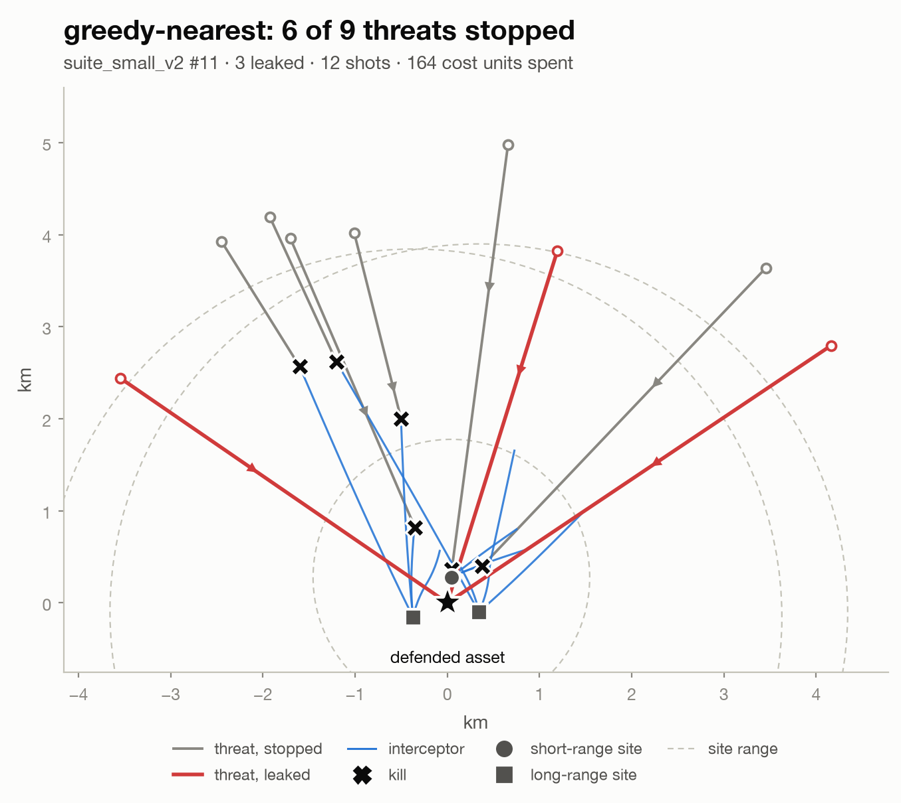

# salvo

who shoots what, when a swarm of cheap drones shows up at once and the radios are getting jammed.

salvo is a weapon-target assignment (WTA) testbed. it's a vectorized 2D engagement sim, exact MILP and
auction (CBBA) baselines, and a graph neural net assignment policy trained by imitation learning on
solver-optimal plans. the end state runs that policy decentralized across raspberry pi nodes that
coordinate over UDP while `tc netem` injects packet loss, latency, and burst outages.

## the problem

cheap drones flip the cost math on air defense: the interceptor costs orders of magnitude more than
the thing it's shooting down. so the whole game is allocation. which effector takes which threat,
solved fast, cost-aware, and re-planned every tick as the engagement evolves. jamming makes it worse:
anything that leans on a central node or a clean network degrades fast once links start dropping.

**question:** under increasing message loss, does a learned decentralized policy hold its intercept
rate better than CBBA, the standard consensus-based auction?

**headline metric:** % of threats stopped vs message-loss rate, every method on identical seeded
scenario suites, reported w confidence intervals.

## stack

- **sim:** numpy, struct-of-arrays, deterministic per seed. pro-nav guidance, swept-segment intercept
  checks, probabilistic kills.
- **baselines:** greedy, hungarian, MILP (OR-Tools) as ground truth at small N, CBBA
  ([choi, brunet & how 2009](https://ieeexplore.ieee.org/document/5072249)).
- **learned:** GNN over a threat-effector bipartite graph, behavior cloning from MILP labels w
  DAgger-style relabeling, trained at ~10 threats and evaluated zero-shot at 500+.
- **deployment:** ONNX export, C++20 inference, binary UDP message protocol, one pi per node,
  virtual nodes to scale past the hardware.

## roadmap

- [x] 0. repo + tooling
- [x] 1. sim, scenario generator, versioned eval suites
- [ ] 2. baselines + eval harness
- [ ] 3. learned centralized policy + scaling study
- [ ] 4. decentralized in sim: CBBA vs GNN under simulated loss
- [ ] 5. raspberry pi deployment
- [ ] 6. jamming sweeps + write-up

## one engagement

<picture>
  <source media="(prefers-color-scheme: dark)" srcset="docs/figures/engagement_example_dark.png">
  
</picture>

made by `scripts/render_engagement.py` (`make figures`). sim details in [docs/SIM.md](docs/SIM.md).

## setup

```
brew install uv   # or see astral.sh/uv
make setup
make test
make lint
make figures   # rebuilds every figure in this readme
```

## scope

everything is abstract. threats and effectors are points w made-up range, speed, and kill-probability
parameters. no real systems, no real specs, nothing export-controlled. an "intercept" is two points
getting within a radius. it's a resource-allocation problem at heart.
