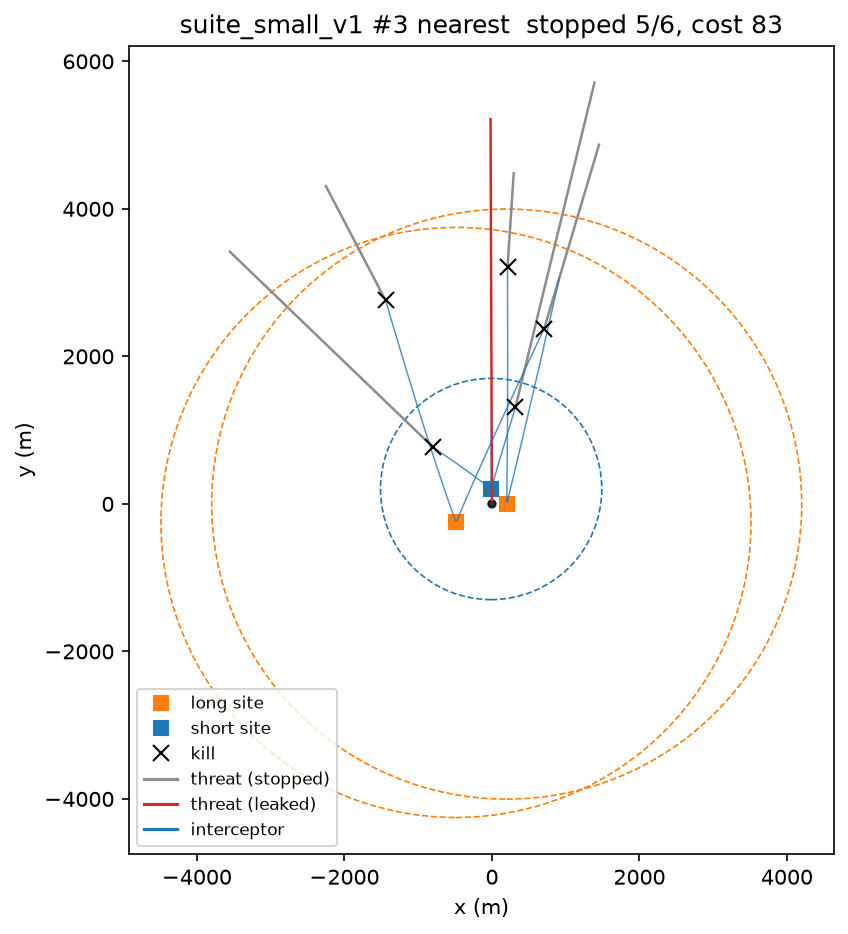

# salvo

decentralized weapon-target assignment for drone swarms, measured on a real jammed network.

## the problem

cheap drones flip the cost math on air defense: the interceptor costs orders of magnitude more than
the thing it's shooting down. so the hard part is assignment. which defender takes which threat
(weapon-target assignment, WTA), done fast, aware of cost, and re-planned constantly as the fight
changes. and when the radios are being jammed, anything that leans on a central computer or a clean
network stops working.

salvo asks: can a learned, decentralized policy hold up under that? each defender runs its own copy
of a graph neural net on its own computer, and they coordinate by sending real packets over a lossy
network. it goes up against CBBA (the standard auction-based approach), exact optimization, and
greedy baselines, all on the exact same scenarios.

**main metric:** % of threats stopped vs % of messages lost.

the building blocks (CBBA, GNNs for multi-robot coordination, learned WTA solvers) come from prior
work. what salvo adds is the measurement: a reproducible head-to-head on real hardware and a real
lossy network, including where the learned policy loses.

## roadmap

0. repo + tooling
1. 2D simulator + scenario generator
2. baselines (greedy, hungarian, exact MILP) + eval harness
3. GNN trained to imitate the exact solver on small fights, tested on much bigger ones
4. decentralized version in sim (CBBA vs GNN) under simulated packet loss
5. raspberry pi nodes running inference in C++, talking over wifi
6. jamming experiments (`tc netem`) + write-up

## one engagement



one scenario from `suite_small_v1` with the greedy-nearest baseline. gray = stopped, red = got
through, blue = interceptors, x = kill, dashed circles = each site's range. made by
`scripts/render_engagement.py` (`make figures`). sim details: [docs/SIM.md](docs/SIM.md).

## setup

```
brew install uv   # or see astral.sh/uv
make setup
make test
make lint
make figures   # rebuilds every figure in this readme
```

## scope

everything is abstract. threats and defenders are points with made-up range, speed, and
kill-probability numbers. no real systems, no real specs, nothing export-controlled. an "intercept"
is two points getting close enough. it's a resource-allocation problem at heart.
